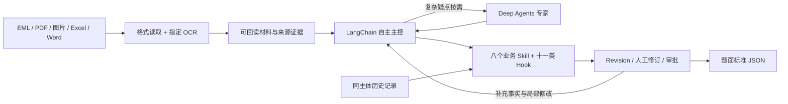

# 航账 Harbor

### 面向航运财务的证据驱动智能体

**把多格式单据转化为可追溯、可修订、可审核的账单决策。**

航账连接邮件、PDF、图片和 Office 表格，从当前记账主体出发提取费用，识别新增、更新、重复与冲突，输出符合题目约定的财务 JSON。模型负责理解材料与自主选择工具；领域代码负责证据、金额、匹配、版本和审批约束。

项目基于 **Python / LangChain / LangGraph / Deep Agents / Vue / TypeScript**。当前交付定位为本机开发与演示系统，具有真实接口接入、历史局部闭环与定向验证记录；不以合成演示或历史测试代替最终独立业务验收。

[项目方案与逐项答辩](docs/project-solution.md) · [PDF 阅读版](output/pdf/Harbor_项目方案与笔试答辩.pdf) · [文档导航](docs/README.md) · [验证记录](docs/acceptance.md)


## 三个工程支点

| 支点 | 实现方式 | 解决的问题 |
| --- | --- | --- |
| **证据驱动决策** | 原件、来源身份、字段引用、位置与原值分别保留；模型引用 ref_id，宿主回读验证 | 避免“有结果却无法说明依据”，缺失字段不猜填 |
| **有界自主执行** | 简单任务批读与直接核验；复杂疑点按需委派；共享预算、两轮修复、无进展停止与可恢复回合 | 减少机械委派和重复调用，避免无限循环与失败后无法继续 |
| **版本化人工闭环** | 聊天修订与表单共用 Revision；重算相关字段、旧审批失效、正式导出检查当前版本 | 避免修改覆盖、旧审批沿用和未经核验的财务输出 |

## 从材料到结果



官方 Agent Server 管理运行与流式订阅，LangGraph 检查点保存执行状态；GaussDB 保存业务版本与回执，Redis 支撑运行投影与缓存，原始 OCR 成功响应另有内容寻址的磁盘缓存。Vue 工作台通过官方 SDK 展示消息、材料、费用、证据与待办。

主控根据当前问题决定读哪里、是否需要专家以及如何解释冲突；计划与委派按需使用。保存提取结果默认完成一次确定性核对，简单任务无需额外调用 `prepare_export`。处理结束、校验通过和人工批准分别表示不同业务状态。

## 对照笔试题的十项方案

完整答辩逐项采用“**问题是什么 → 如何解决 → 为什么 → 更好的方案**”，并给出源码落点和验证范围。

| 验收 | 当前方案 |
| --- | --- |
| [01 邮件解析](docs/project-solution.md#acceptance-01) | MIME 正文与附件递归接入；保留父子关系、重复出现身份及局部失败 |
| [02 指定 OCR](docs/project-solution.md#acceptance-02) | 可下载 URL、固定请求契约、原始响应、页/帧映射与成功缓存 |
| [03 Office 表格](docs/project-solution.md#acceptance-03) | 单元格与 OOXML 读取，公式/缓存区分，旧格式转换和血缘保留 |
| [04 核心字段提取](docs/project-solution.md#acceptance-04) | 编号、费用、金额、币种按字段引用；Decimal 核验；不明值留 null |
| [05 新增与更新](docs/project-solution.md#acceptance-05) | 自动历史检索、四级唯一匹配、明确更新授权与未改字段继承 |
| [06 AR/AP](docs/project-solution.md#acceptance-06) | 从当前主体与真实债权债务关系判断，区分方向与 PP/CC 条款 |
| [07 重复与冲突](docs/project-solution.md#acceptance-07) | 分开处理文件去重、费用身份、业务重复与跨来源矛盾 |
| [08 Harness](docs/project-solution.md#acceptance-08) | 原生执行限制、共享请求预算、证据保护、停止/恢复与导出门禁 |
| [09 补充思考](docs/project-solution.md#acceptance-09) | 缺失、条件费用、跨币种、更新授权、经验与性能等十项讨论 |
| [10 工程交付](docs/project-solution.md#acceptance-10) | Python + LangChain、模块职责、依赖锁定、便携启动与私人 Git 仓库 |

## 为什么采用 LLM + OCR

题目明确要求 PDF、图片使用指定 OCR，并采用 Python 与 LangChain。因此主链路采用 **指定 OCR + 文本 LLM + 确定性核验**。保留可用文字层、表格结构和原图定位，避免把服务返回的业务 JSON 当作原件逐字全文。

**VLM 是值得评估的增强方向。** 复杂表格、币种表头、扫描标注和错列信息依赖视觉布局，VLM 有机会改善纯 OCR 文本的缺口；本项目尚无独立 A/B 数据，不能宣称已测得具体提升。若约束允许，建议对疑难页一次复核全部相关字段，再与 OCR 和代码校验对照。项目已有 VLM 配置位置，当前财务主链路未启用自动 VLM 核验。

我们推测题目也在考察长上下文与噪声处理，这是设计理解，而非出题方的明示要求。把所有 OCR、邮件头、条款、历史消息和工具返回反复送入模型，会增加成本、延迟和无关信息。当前采用以下方式组织上下文：

- 短材料包一次批量读取；默认 32,000 **字符**阈值，不能当作 token 数。
- 长材料先给清单，再通过原生检索与窗口读取扩读；保留截断提示与未读范围。
- 原文外置并可回读，引用使用 ref_id；校验反馈去重压缩，完整报告仍保留。
- 使用官方上下文编辑清理较早工具输出；不以模型改写后的摘要替代原始财务证据。

## 快速启动

1. 确认 `backend/.env` 已配置模型、数据库、Redis 及材料接入服务，启动其中指定的本机 Redis。
2. 双击根目录 **start.cmd**，等待官方 Agent Server 启动。
3. 打开 **http://127.0.0.1:2024/app/**；业务健康检查为 **http://127.0.0.1:2024/api/health**。

项目提供 Windows x64 便携 Python 环境，启动入口按自身位置定位。使用随项目已构建页面时，无须额外安装系统 Python、conda 或 Node.js；前端开发构建需要 Node.js。便携运行时、本机密钥和业务原件不会进入 Git，单独从源码克隆需按 [后端说明](backend/README.md) 准备环境。默认端口 2024，当前为本机单实例服务。

### 合成材料演示

上传 `backend/tests/fixtures/synthetic-invoice.xlsx`，当前记账主体填写 **Demo Trading Ltd**。在没有合格历史匹配的演示环境中，预期两笔 AP / CREATE：Handling Charge 50 USD、Documentation Fee 20 USD。工作台自动检索历史，同一合成材料重复运行可能形成 NO_CHANGE 或复核；调用方也可显式提供已有账单范围。

查看原文依据和校验结果，明确批准当前版本后导出 JSON。可将金额 50 改为 51，演示新 Revision、重算与旧审批失效；恢复正确金额后重新审核。历史合成输出见 [synthetic-bills.json](backend/examples/synthetic-bills.json)，它不是原题材料的真实提取结果。

## Harness 与人工协作

基础任务配置为 **24 次模型请求 / 64 次工具派发 / 1200 秒活跃时间**；初始 run 模型上限 16，单类专家每轮 4，给主控预留 2。子 Agent、重试等真实请求共用计量；明确人工新回合有有限增量，累计账本不会清零，自动续跑不无限增加额度。以上是执行上限，不是平均调用量或时延承诺。

纠错到限、同事实无进展或预算耗尽会停止新派发，保留候选、缺口和可恢复状态。修复不得无依据覆盖已有证据；停止不会被显示为核验通过。十一类 Hook 对正式导出检查 schema、coverage、evidence、amount、matching、update、posting、revision、approval、capability、budget。

聊天常驻，用户可以问问题或修改指定费用；旧待办独立提醒，不阻塞用户当前意图。原生 interrupt 回复、普通聊天、失败重试和已结束线程继续分别使用适当入口。无论聊天还是表单，修订后都要重新核验当前版本。

### 可检索的纠错经验

进化库支持从账单生成 AI 经验草稿，自动关联来源、版本与主体；用户确认后，同主体新任务可通过本地 BM25 检索最多 3 条相关经验。**使用已确认经验** 总开关可关闭检索，单条经验可停用；运行中任务保留原版本快照。

经验描述核对方法，不能替代当前材料的金额、币种或收付款事实。改变确定性费用映射须经过执行规则的评测、审核发布与回滚；参考经验不会自动修改财务规则或模型权重。详细使用流程见 [进化库记录](docs/research/experience-library-20261023.md)。

## 工程结构

```text
backend/
  agents/             主控、文档专家、账单专家与工厂
  middleware/         原生中间件组合、会话和工具边界
  tools/ hooks/       领域工具绑定与十一类约束
  harness/            共享预算、派发与停止控制
  skills/             八个可迁移业务包
  infrastructure/     模型、资产、仓储与检查点
  api/ config/ mcp/   业务接口、配置与能力接入
  tests/ evals/       定向检查、评测及合成样本
frontend/             Vue + TypeScript + Vite 工作台
docs/                 方案、架构、历史测量与验收记录
output/pdf/           项目 PDF 阅读版
start.cmd             Windows 启动入口
```

八个业务包依次为 document-intake、document-extraction、evidence-linking、billing-reconciliation、billing-confidence、human-review、billing-export、feedback-improvement。框架执行机制与财务算法分开，复杂外部能力可由 MCP 接入，任务固定 Skill 内容快照。

Python 直接依赖与完整锁分别在 `backend/requirements.txt`、`backend/requirements.lock.txt`；前端使用 `frontend/package-lock.json`。项目锁定组合包括 LangChain 1.4.6、LangGraph 1.2.16、Deep Agents 0.7.30，升级需另行验证。

## 验证范围与交付边界

| 已有证据 | 可以说明什么 | 仍待验证 |
| --- | --- | --- |
| 指定 OCR 历史真实请求、OBS 上传与哈希核对 | 题面接口接入及真实响应契约可用 | 各文档家族识别准确率与规模性能 |
| 单三页 PDF 冷 OCR 约 208.74 秒；缓存零网络回放约 0.88 秒 | 远程等待和成功响应复用是不同瓶颈 | 不是端到端提速倍数，也非平均时延 |
| 历史真实模型、人工介入及局部导出记录 | 部分业务闭环有实际回执 | 最终独立金标、真实长材料、完整故障/并发矩阵 |
| 两文件离线模拟链路 3 次模型 HTTP | 简单主控路径已精简 | 不是线上平均调用次数 |
| 最新前端 21 项定向检查、类型检查与构建；合成布局验证 | 当前界面相关路径有局部验证 | 不是全量业务回归 |

较早第 4/8 项开发样本仅有 **2/4 包字段完全匹配**，其失败被用于修复；该成绩不能当作最终准确率。详细方法、版本和局限见 [项目报告](docs/project-solution.md)、[验收记录](docs/acceptance.md) 与 [研究目录](docs/research/)。

本轮仅更新文档与生成 PDF，没有新增真实模型/OCR调用、没有运行全量测试、没有启停后端。实际开发应按改动范围选择离线检查；真实调用须遵守用户预算授权。外部财务正式入账、生产 SLA、权限体系和 VLM 增强仍属于进一步工作。

开发前先阅读 [AGENT.md](AGENT.md)。其他入口：[架构](docs/architecture.md) · [恢复](docs/recovery.md) · [性能](docs/performance.md) · [补充思考](docs/insights.md) · [前端](frontend/README.md) · [便携环境](docs/portable-environment.md)。
