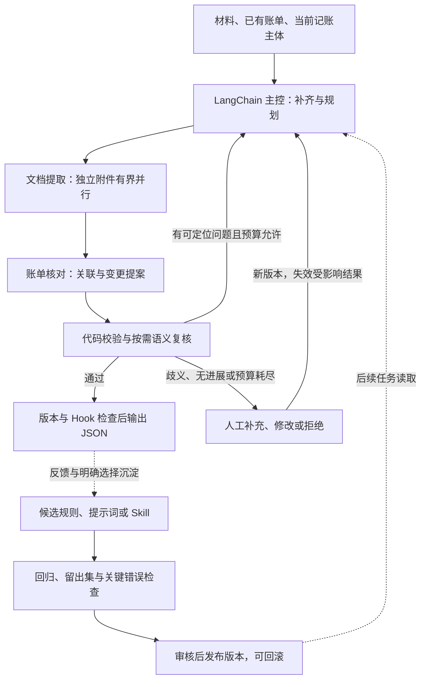

# 官方案例研究与本项目架构选择

> **历史选型快照，2026-10-21复核。** 仓库/commit事实保留；当前已选择官方Deep Agents组件及专家子Agent。早期“首期不强制安装”、统一工具网关、宿主领域服务或Redis重复排队建议不再适用。后续以[当前实现方案](implementation.md)、[Skill/Hook设计](skills-and-hooks.md)和[最终开发计划](superpowers/plans/2026-10-21-final-development-plan.md)为准，逐职责先查LangChain MCP。

核验日期：2026-10-21，Asia/Shanghai。优先使用 GitHub MCP 阅读冻结版本的源码与测试，终端仅辅助定位。本文记录研究依据和设计选择；后续开发约定以根目录 `AGENT.md` 为准。本文不代表已实现业务 Agent、热插拔、人工恢复或持续改进。

## 1. 研究范围与版本

没有仅凭 README 推断能力，也没有运行示例中的模型调用、邮件发送或外部写入。下表是开始读取时固定的快照，持续更新的仓库可能已出现后续提交。

| 官方仓库 | 固定 commit | UTC 提交日期 | 核验时的定位 |
| --- | --- | --- | --- |
| open_deep_research | `1b7d2e80db9faa586165c60e09096dbbfd483a64` | 2026-08-10 | 已归档；完整研究应用的历史参考 |
| langgraph-supervisor-py | `88859b34017ac3569bbd4a3092c7e77593a0a960` | 2026-07-15 | 已归档；主管与交接模式的历史参考 |
| langgraph-swarm-py | `5442a15cdd0ed210589148900c9960c24c489d04` | 2026-09-20 | 未归档；去中心交接库与示例 |
| langgraph-reflection | `888d007163f1479e1e7a734f66dc7dcbd12424d7` | 2025-03-18 | 已归档；反思循环的简短示例 |
| deepagents | `3abfb0abcda658d4b64e74782f3316a11efc3faa` | 2026-10-20 | 未归档；0.7.29 SDK、应用示例和评测 |
| agents-from-scratch | `603fc7a4ac6119004f43894395e504a1fefcc6c0` | 2026-08-11 | 未归档；邮件助手教学应用 |
| langmem | `48e3c11f5bb527282c7d5339c6a87a0b35abccfc` | 2026-10-02 | 未归档；记忆与提示词优化原语 |
| openevals | `9166120ee4e7daaf847b82dd6f18993777a5cc30` | 2026-10-19 | 未归档；评测器与测试 |

归档状态通过 GitHub MCP 仓库元数据核实。Open Deep Research 网页横幅另外给出 2026-08-21 归档日期；其他仓库不从提交时间推算归档日期。官方示例、教学项目、SDK 和评测原语分别提供不同证据，不能全部称作已验证的生产系统。

详细源码笔记：

- [研究应用与主管](research/supervisor-and-research.md)
- [Deep Agents harness、Skills、子 Agent 与评测](research/deepagents.md)
- [人工干预、长期记忆与评测](research/feedback-and-learning.md)
- [原生 LangChain 文档/API MCP 与 GitHub 的补充交叉核验](research/langchain-mcp-crosscheck.md)：当前协同教程、LangChain 1.4.6 内置 MCP、人工介入接口、隐含模型预算与独立最终评测。

## 2. 实际出现的协作类型

| 类型 | 源码证据与实际行为 | 对本项目的选择 |
| --- | --- | --- |
| 分流与混合工作流 | 邮件助手 `triage_router` 分流 respond/ignore/notify；Open Deep Research 先澄清再进入研究 | 格式识别、确定性解析优先使用代码分流；主体与资料是否充分由主控检查 |
| 主管调用专职子 Agent | 主管委派并收回结果；Deep Agents 的 `task` 工具组织独立子任务上下文 | 作为核心协作方式，LangChain 主控调用工具封装的专职子 Agent |
| 并行分发与汇总 | Open Deep Research 通过 `asyncio.gather` 并行研究，再汇总压缩结果 | 独立附件并行提取，结构化证据汇总；同一账单的修改由统一业务服务串行裁决 |
| Handoff / Swarm | `create_handoff_tool` 返回 `Command.PARENT`，写 `active_agent`；下一轮从最后活跃角色继续 | 适合对话中转接专家；本项目首期不以它为主架构，保持统一账单版本与提交出口 |
| 生成—评价—修订 | Reflection 的候选图与评价图循环；Rubric 用 `jump_to='model'` 要求修订 | 用于有界、针对具体问题的纠错；代码校验优先，模型评审补充语义判断 |
| 人工中断与恢复 | 邮件助手 `interrupt_handler` 支持接受、编辑、自然语言反馈和忽略 | 支持处理中修改、补充、重做受影响部分和续跑，人工输入生成新版本 |
| 跨任务记忆与外层优化 | LangMem 改写候选提示词；better-harness 比较 baseline 与候选后决定接受 | 建立独立的候选、评测、发布流程，区别于当前账单的纠错循环 |

这些类型可以组合。多 Agent 的必要性来自上下文、工具和职责差异，不由角色数量决定。

## 3. 值得借鉴与不能照搬的代码

### 3.1 分层研究与主管

[Open Deep Research 的主图与研究循环](https://github.com/langchain-ai/open_deep_research/blob/1b7d2e80db9faa586165c60e09096dbbfd483a64/src/open_deep_research/deep_researcher.py)体现澄清、简报、并行委派、研究员工具循环和结果汇总。其压缩上下文方式可借鉴，但财务字段必须另存页码、表格行和原文引用，不能只留下摘要。

该源码 `supervisor_tools` 的异常分支包含 `is_token_limit_exceeded(...) or True`，会在异常后结束研究，外图仍可生成报告。账单应用必须区分正常完成、服务失败和待复核。模型停止调用工具，也不能作为财务校验通过的证明。

[Supervisor 装配](https://github.com/langchain-ai/langgraph-supervisor-py/blob/88859b34017ac3569bbd4a3092c7e77593a0a960/langgraph_supervisor/supervisor.py)有明确的子 Agent 返回主管边，但内部仍调用旧的 `create_react_agent`。其 README 建议多数新项目直接通过工具实现主管模式。首期不引入这个归档库。

### 3.2 Swarm 与反思

[Swarm 路由](https://github.com/langchain-ai/langgraph-swarm-py/blob/5442a15cdd0ed210589148900c9960c24c489d04/langgraph_swarm/swarm.py)与 [handoff](https://github.com/langchain-ai/langgraph-swarm-py/blob/5442a15cdd0ed210589148900c9960c24c489d04/langgraph_swarm/handoff.py)保存活跃角色，交接时传递消息与控制权。`backend/tests/test_swarm.py` 验证跨轮转给 Bob、再转回 Alice。这不是账单审查完成条件，也没有提供财务事务一致性。

[Reflection 核心](https://github.com/langchain-ai/langgraph-reflection/blob/888d007163f1479e1e7a734f66dc7dcbd12424d7/src/langgraph_reflection/__init__.py)先执行候选图，再执行评价图。评价器追加 `HumanMessage` 时回到候选图，剩余步数不足时结束；没有业务通过状态。[coding 示例](https://github.com/langchain-ai/langgraph-reflection/blob/888d007163f1479e1e7a734f66dc7dcbd12424d7/examples/coding.py)用 Pyright 的具体错误驱动修订，这比仅让模型泛泛自评更适合借鉴。循环因预算结束不意味着正确。

### 3.3 Deep Agents 的 harness

[create_deep_agent](https://github.com/langchain-ai/deepagents/blob/3abfb0abcda658d4b64e74782f3316a11efc3faa/libs/deepagents/deepagents/graph.py#L995)最终调用 LangChain `create_agent`。可复用其子任务、文件上下文、摘要和 Skill 加载思路，作为受控可选子 Agent；默认工具、模型和预算必须重新明确配置。

本次源码中的关键边界：

- 默认递归上限为 9999；deep_research 示例的若干并发、轮次与搜索限制只存在于提示词，不能当成代码预算。
- 普通子 Agent 不全部继承主控定制 middleware；只拦截外层 `task` 不足以控制所有内部工具。业务限制应落实到统一工具网关，并在需要的子 Agent 中显式安装 middleware。
- [SkillsMiddleware](https://github.com/langchain-ai/deepagents/blob/3abfb0abcda658d4b64e74782f3316a11efc3faa/libs/deepagents/deepagents/middleware/skills.py)已有索引、正文渐进披露和关联工具延迟公开；执行时 resolver 可撤回工具，但没有本项目要求的完整版本快照、配置发布事务和审批失效机制。
- [RubricMiddleware](https://github.com/langchain-ai/deepagents/blob/3abfb0abcda658d4b64e74782f3316a11efc3faa/libs/deepagents/deepagents/middleware/rubric.py)在 Agent 结束后评级；`grader_error` 和迭代上限同样可能让它结束。调用方必须检查明确状态。

### 3.4 人工反馈与外层改进

[邮件助手](https://github.com/langchain-ai/agents-from-scratch/blob/603fc7a4ac6119004f43894395e504a1fefcc6c0/src/email_assistant/email_assistant_hitl_memory.py)的 edit 分支先执行工具，再更新长期偏好；后续模型确实读取这些偏好。但示例使用固定 namespace，缺少财务规则推广审查。其自动响应测试明确只支持 baseline，不能声称 HITL/记忆收益已经由这些测试证明。

[LangMem GradientPromptOptimizer](https://github.com/langchain-ai/langmem/blob/48e3c11f5bb527282c7d5339c6a87a0b35abccfc/src/langmem/prompts/gradient.py#L362)根据轨迹和反馈生成新提示词，不自动完成留出集比较或发布门禁，也不是模型权重训练。

[better-harness 的 run_experiment](https://github.com/langchain-ai/deepagents/blob/3abfb0abcda658d4b64e74782f3316a11efc3faa/examples/better-harness/better_harness/core.py#L864)提供真实的外层实验循环：跑 baseline、提出变体、跑 train/holdout、比较、保存报告。它按总通过数增加接受候选，仍可能掩盖个别场景退步；本项目需增加关键财务错误的单独门禁。

后续用文档 MCP 和新固定源码快照交叉核验还确认：holdout 分数参与逐轮接受候选，属于选择过程；源码另有循环结束后的可选 scorecard。最终独立评测不能反复参与同一轮调参，详见 [补充核验](research/langchain-mcp-crosscheck.md)。

[OpenEvals strict 轨迹比较](https://github.com/langchain-ai/openevals/blob/9166120ee4e7daaf847b82dd6f18993777a5cc30/python/openevals/trajectory/strict.py)比较消息角色和工具参数等，但不比较普通正文或工具返回正文。流程得分不能替代账单字段、金额和副作用断言。

## 4. 最适合本项目的组合

采用 **LangChain 主控 + 按需专职子 Agent + 确定性规则服务 + 有界纠错循环 + 人工介入 + 独立改进评测**。

初始配置三个主要角色：

1. 主控：检查记账主体和材料，规划与分派，解释缺失信息，选择下一步。
2. 文档提取子 Agent：处理格式工具提供的内容，返回字段候选、原值和来源；可按附件并发实例化。
3. 账单核对子 Agent：分析跨材料关联、修改意图、交易方向和歧义，返回候选及依据。

复核是独立子流程：先运行代码校验，必要时启用隔离上下文的语义审查角色。无需每笔简单账单都增加一次模型调用。同模型的另一轮审查不等于独立正确性保证。

金额、schema、字段继承、匹配约束、版本检查、幂等和最终操作由代码裁决。专职 Agent 返回提案，不能各自覆盖同一账单。主控采用 `create_agent`；LangGraph 作为其底层运行时或被调用的局部子流程，不替代用户要求的 LangChain 主编排。Deep Agents 为可选适配器，首期不强制安装。

## 5. 三种循环与 harness

### 5.1 当前任务内的行动循环

主控读取状态与证据，选择工具，接收结构化结果后决定下一步。网关约束本地工具、MCP、Skill 脚本及子 Agent 工具；工具热禁用、Hook 拒绝和人工暂停必须真正阻止新调用。

### 5.2 当前任务内的纠错循环

校验返回结构化问题：问题代码、字段、来源、期望约束、可修复性和影响范围。主控只重做受影响步骤，并保存每轮候选和差异。例如币种误提取导致匹配错误，先回到对应文件与行复核，再重做匹配与金额汇总。

首期每个受影响产物最多自动纠错 2 轮；相同候选和相同问题重复出现、没有新增证据或问题本身需要调用方确认时，提前进入复核。并发、模型/工具总调用数和活跃执行时长另设共享预算；子 Agent 和重试共同消耗预算，不能用递归上限代替。到限只能给出明确的待复核/失败状态。

人工确认的字段在当前 revision 中锁定为输入约束；后续模型不得静默覆盖。人工修改也要通过代码校验。未受影响的 OCR 可复用，审批和导出则根据依赖失效。

这里的反思是“对照证据复核并修订候选”的应用循环。每次 Qwen 调用依旧实际传 `enable_thinking=false`，只保存短业务依据，不索取内部思维链。

### 5.3 跨任务改进循环

默认反馈只作用于当前任务。调用方明确选择沉淀后，生成候选规则、费用映射、提示词或 Skill；记录适用主体/交易方/单据类型、来源、差异和版本。候选与当前有效版本分别保存。

用反馈样本和回归/验证样本比较新旧版本，并另保留不参与本轮候选生成或接受的最终独立评测集；反复参与选择的 holdout 不再算最终独立测量。按业务或单据家族去重划分，避免同封邮件附件跨组泄漏。模型自生成的标签不能直接当真实答案。

关键检查包括金额、币种、主体、AR/AP、误 CREATE/UPDATE、同名多行误合并、来源丢失和重复副作用；每项单独判定，不以总体平均分替代。候选须展示对照结果与失败样本，经明确审核后发布；运行中任务固定版本，更新与回滚只在明确边界生效。

这属于可评测的规则/提示词/Skill 改进，不宣称自动训练了 Qwen，也不让线上 Agent 自行改写业务代码或静默发布全局规则。

### 5.4 Harness 的职责

Harness 是支撑上述循环的执行与验证设施，至少覆盖状态/证据管理、上下文裁剪、统一工具网关、MCP/Skill 版本、middleware/业务 Hook、共享预算、错误分类、人工中断、持久检查点、幂等执行账本、审计回放与评测。

官方当前 `create_agent` 文档已明确说明用 middleware 组合 harness。项目继续以 LangChain 为主控；评分器、摘要和修复等内部请求使用同一模型工厂、实际关闭思考并计入共享预算。工具重试每次真实派发也重新检查禁用和暂停；旧适配库、原生接口及未安装可选依赖的区别见补充核验。

GaussDB 保存任务版本、人工修改、执行事实与恢复依据；Redis 承担排队、通知与事件传递。checkpoint/store 与 GaussDB 驱动的真实兼容性仍需验证。前端展示当前阶段、来源与字段差异、纠错轮次、暂停状态、待复核原因，以及候选版本的评测与发布结果。

## 6. 后续实现须证明的结果

- 校验失败能定向回退；两轮未修复进入待复核，不把循环结束当通过。
- 人改币种/主体后，相关匹配、AR/AP、汇总与审批失效；原始材料和人工修订保留。
- 父/子 Agent 经过同一工具执行约束；热禁用后未派发的调用次数为零。
- 成功工具后的 Hook 失败不会导致副作用重复；重启后能恢复同一任务。
- 当前任务纠错不会自动改写共享 Skill；候选评测退步不能发布，发布可回滚。
- 全部模型入口真实关闭思考模式；过程评测和最终业务正确性分开检查。

当前仅完成研究与约定更新。业务代码、在线模型、OCR、GaussDB 持久恢复及上述验收尚未实现或验证。
