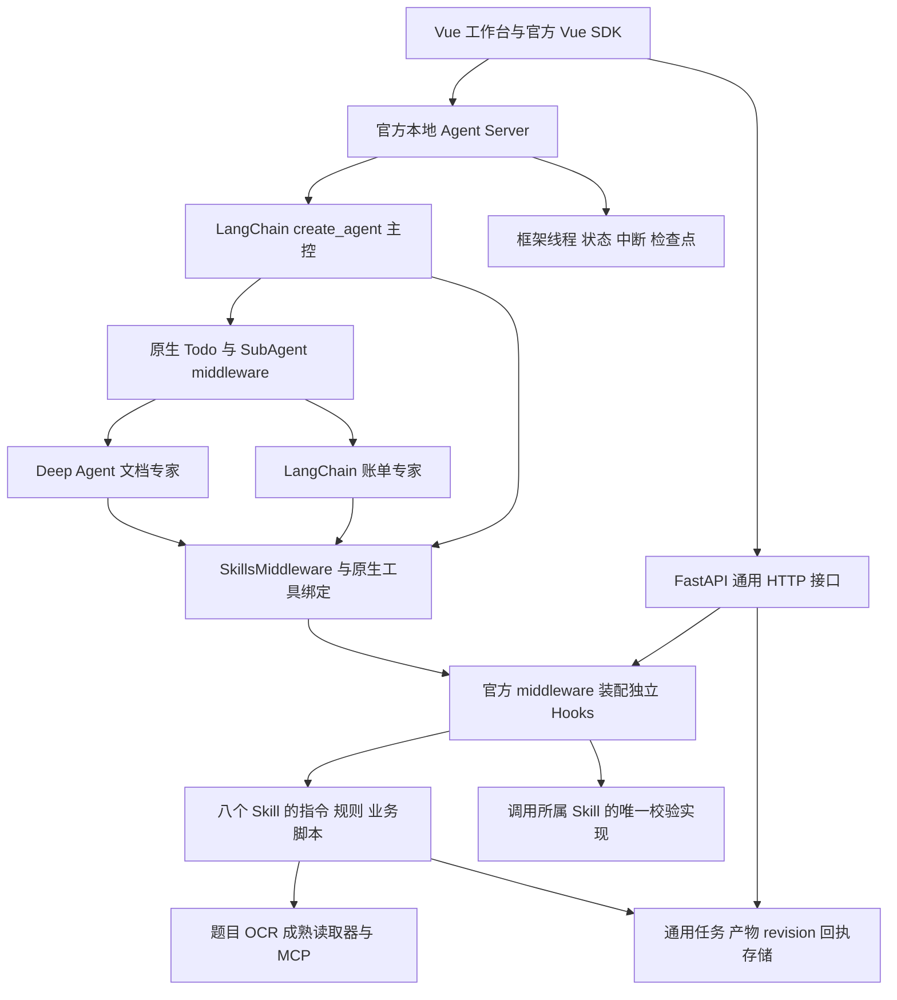

2026-10-22 主控动态闭环：按本机 Codex 源码职责对齐。主控使用原生 TodoListMiddleware/write_todos 按轮规划与阶段更新，工具/子Agent结果交回主控验收，再决定补读、修正、委派、询问或结束；不增加自定义runner、强制工具选择或独立反思模型。codex风格的prepare_export不再return_direct，保存/最终工具返回实际verification评分与缺口；漏调最终工具时，既有TaskOutcome通过原生after_agent/jump_to=model回传未见核验，同revision再写入不能沿用旧回执。规则支持分不是统计正确率，缺信息不强制复核。40项定向测试通过（1 warning、12.29秒），未做全量测试、真实OCR/Qwen重跑或20秒性能验证。见docs/research/supervisor-dynamic-planning.md及backend/tests/reports/supervisor-loop-pytest.xml；服务状态见backend/tests/reports/supervisor-loop-restart.json。以下旧交互/进程记录保留历史范围。

2026-10-22 当前实现：账单处理采用Codex式会话，只有真实人工中断显示内联输入框；原生线程的主体/费用修改、拆分/删除及针对性复核入口转到会话，用户只需自然语言。原生HITL与middleware复用，字段修改交给现有human-review Skill，新revision后重新核验，不能默认批准。32项定向测试通过，Vue类型/生产构建通过（2494 modules，Vite0.961秒，index-BShsDezv.js）；隔离真实Agent Server+合成模型/材料/存储的浏览器验证两轮回复、revision1→3、刷新恢复、结束隐藏输入框及无审核弹窗。未做全量测试或真实OCR/Qwen语义复测。详见[会话审核架构与验证](research/conversation-review.md)、backend/tests/reports/conversation-pytest.xml及conversation-ui.json；当前进程/32线程保留见conversation-restart.json。以下旧表单及进程数字保留历史身份。
# 航运智能账单助手：前后端实现方案

## 2026-10-22 人工反馈与Agent运行闭环

人工revision保存与图的执行分开：结束后的任务用同一thread的普通input开启下一轮；原生interrupt等待真实respond；暂停/预算不足保留修订。运行装配绑定revision，在原生模型middleware注入当前人工反馈，并复用已有材料/补读。after_agent核验反馈是否实际被模型读取，再核验当前业务结果；运行受理/成功不能覆盖已完成结果或冒充财务通过。失败后使用现有control.resume继续，不重复应用修订、不清零预算、不修改已发布Skill或历史能力。完整职责、目录与验证见[Harness闭环说明](research/harness-revision-feedback.md)。本节覆盖下文“人工修改只重算”的旧描述。

# 2026-10-21 Codex式阅读重构

最新用户指令覆盖旧的强制流程：短材料一次批量阅读，长材料通过原生grep/read_file定位扩读；主控自主决定顺序、计划和是否委派。document专家处理复杂阅读，billing检验专家只处理指定候选/疑点。图片查看改为指定OCR，Qwen仍关闭思考。取消九块覆盖、强制逐字段回读和双侧关联证明；引用使用ref_id恢复原文位置。保存后返回结果与缺口，缺失/低分不强制中断。具体实现、比较和验证见[本轮记录](research/codex-style-extraction.md)。以下架构图和状态按其原版本保留，与此段冲突时以此段为准。

## 最新审核分流（2026-10-21）

运行路径为提取→确定性校验与Skill置信度→条件人工中断/自动核验完成。只有已有字段或有原文raw值的未明确解释字段低于可配置阈值（默认80）才中断；缺失信息及缺可选算术/总额不计低置信度。billing-confidence保留整体证据支持分，新增review_score/review_items/review_required；页面展示已有字段置信度，不能用整体分缺失可选项的扣分制造人工待办。

human-review.review_outcome产生自动核验事实及精确版本绑定。正常结果completed，无人工必经审批；低分使用原生langgraph.types.interrupt，用户可在六字段表/原件窗口修改后通过官方Vue respond恢复；completed_with_gaps仅表示结果已保存，不能导出不合法的可执行账单。prepare_export和原生after_agent共用同一薄适配，模型漏调导出工具时仍做最终核验。旧能力保持其原有规则，不重写历史任务。

主体提交的409分为仍在运行、实际版本冲突和策略禁止；前端保留输入、核对重叠字段并允许重试。更多信息为按费用分组的纵向字段表。规则、官方查证及验收见[条件复核说明](research/conditional-confidence-review.md)。下文显式审批与旧分数页面的描述保留为历史记录，新开发按本节和AGENT.md执行。

更新日期：2026-10-21。当前已实现按职责划分的后端、Vue业务工作空间与八个业务 Skill。继Office读取/转换和原文复核后，已补无模板海外材料的原文数值保留、全球数字/币种歧义校验及三组融合支持度；统一evidence Hook阻断核心字段无来源或歧义，不把它仅作为低分提示。XLS/XLSX保留单元格、公式与缓存，项目内LibreOffice实际重算公式并转换合成OLE DOC/XLS；Word保留原内容顺序并提供绑定转换版本与PDF哈希的只读版式。Vue展示当前revision的费用/字段分、核验不足、原文候选及可定位来源。独立真实财务金标、长材料性能及转换程序移机仍未验收；本轮优先完成需求，暂不处理交付包。开发约定以根目录 `AGENT.md` 为准。

本次前端已从单页工作台拆成面向用户的工作总览、独立大屏、账单业务中心、待办复核、独立材料提交页、账单详情及管理中心的能力/经验子页面。Hash导航、同次页面会话的列表缓存、摘要与详情分开读取、技术日志折叠与人工中断持续显示均已实现，Vue/TypeScript检查和生产构建已通过（2408 modules，Vite 1.71秒）。新版浏览器主要路径、390×844布局、移动菜单及测试标签API阻断后的快照保留/恢复通过；完整键盘、长表、视口与断线矩阵仍待验。页面、验收边界与目录见§11–12，旧工作台截图不作为新版页面验收。

本轮领域实现版本为document-extraction 1.3.0、evidence-linking 1.2.0、billing-reconciliation 1.1.0、billing-confidence 2.0.0；原文数字解释、财务运算和评分各保留唯一责任包，详见[海外提取与融合研究](research/global-extraction-confidence.md)。9个显式合成差分场景、前端类型/生产构建与SSR呈现已有实际记录；这些不是独立真实金标或本轮浏览器联调。

当前skills已通过CAS发布v6，能力快照 `0dd7d9b036a29571747e`；最终全量 **353 passed、43 warnings、4 subtests passed，220.45秒**。发布与测试分别见 `backend/tests/reports/global-confidence-publication.json`、`global-confidence-pytest.txt`、`global-confidence-pytest.xml`，历史任务未迁移。另有真实Qwen合成在线回归及浏览器：欧洲格式两条EUR费用正确且支持度100，裸$1,234保持null和24分待复核、批准/导出422；详见[本轮验收](acceptance.md#无模板海外提取与融合v22026-10-21)。它们均不替代独立真实金标，活跃约325–366秒仍偏高。

此前Office批次skills配置经CAS发布为v5，能力快照为 `3eb8bfbc62c9d4f41004`：document-intake 1.2.0、document-extraction 1.2.1、evidence-linking 1.1.2、billing-reconciliation 1.0.1、billing-confidence 1.0.2等。该批次全量为234 passed、43 warnings、4 subtests passed（151.92秒，退出0），不充作本轮新算法回归结果。固定答案浏览器样例已通过直接确认→改错/422→改回/重评分→重新确认闭环；实际在线与固定答案分别记录在 [验收记录](acceptance.md)，不以该样例推断模型准确率。历史任务保持其固定快照，不静默迁移。

初次真实Qwen合成在线验证保留失败边界：DOCX两条费用50/20 USD进入 `ready_for_review`，规则支持度65、中分，未满足快速确认；XLSX提取同额两条费用后，在最终说明阶段触发24次共享模型预算，业务为 `budget_exhausted`。这些旧快照未用后续规则重算，不代表新版本闭环通过，也不是独立准确率或P50/P95。详情见 [历史Office验收](acceptance.md#历史officev5置信度与原文复核2026-10-21) 和 [原始在线报告](../backend/tests/reports/office-confidence-online.json)。

此前v5另建DOC/XLSX在线回归，均成功生成两条CREATE/AP、50/20 USD，规则支持度100且无校验错误；活跃时间分别425.392/246.782秒，仍需降低短材料调用开销。这是旧策略的合成样例功能验证，不替代本轮新算法、长材料性能或独立金标。浏览器固定答案的确认、改错拦截和恢复后重新确认也已完成，详见验收记录。

职责重构的163项全量回归（43 warnings、4 subtests、68.90秒）、后续40项配置定向回归（28.73秒）、项目外运行时/pip check、四HTTP全200及三个历史任务保留均为此前批次证据，报告为 `backend/tests/reports/responsibility-tests.txt`、`responsibility-configuration-tests.txt`、`responsibility-runtime.json` 和 `responsibility-after.json`。旧结构工作区和ZIP迁移结果只覆盖各自历史版本，不证明本轮Office与置信度功能已经移机。

已按最新用户约定完成文档核对；统一任务清单见 [最终开发计划](superpowers/plans/2026-10-21-final-development-plan.md)，实际状态及文档用途见 [文档导航](README.md)。研究记录中的旧网关/宿主业务服务/saver建议不能覆盖当前设计。

当前已有 `backend/`、Vue工程、八个含规则/脚本/独立入口的业务Skill，以及 `backend/config/hooks.yaml` 声明的十一类Hook。LangChain 1.4.6、Deep Agents 0.7.29、LangGraph 1.2.16、Agent Server API 0.16.2、Vue SDK 1.2.5等已落入依赖及锁文件；OBS采用esdk-obs-python 3.26.6。真实Qwen/业务存储与官方前后端已接入，历史合成Excel任务 `abab67c9-2fe2-44fe-a416-6dbd92058b26` 已人工批准并导出，产物为 `backend/examples/synthetic-bills.json`；SQLite重启后保留消息、检查点与EML原中断。目录调整前的工作目录完整回归为 **161 passed，43 warnings，4 subtests passed，28.81秒**，原始报告为 `backend/tests/reports/pytest.txt`、`pytest.xml`；OBS候选包迁移回归为 **161 passed，43 warnings，4 subtests passed，41.16秒**，报告为 `backend/tests/reports/app-portability-obs.json`、`app-portability-obs-tests.txt`。SQLite的58个必需基础conformance在完整回归中作为1项测试执行，不另行相加；此前140等批次及旧目录迁移结果保留为历史证据。

原题PNG与两份PDF已验证OBS上传、签名下载哈希及指定OCR响应；PNG的后续映射使用原真实响应回放。新EML任务 `edfd9e4f-a0a7-4aa5-9349-07eb29169cc1` 的4来源均ready，正文 `$50` 候选缺币种与收费双方，已原生中断请求补充；正式导出HTTP 422，0条正式records。服务run_status为success只表示本次框架运行结束，业务仍awaiting_input，详见 `backend/tests/reports/obs-agent-task.json`。

当前实现与完整设计有以下差距：

- 默认 `StateBackend` 只提供虚拟文件；包内 Python 函数经官方 Skill tools 绑定执行，未启用 shell `execute`。独立 CLI 已有项目外调用检查，不代表任意宿主的完整拦截策略自动迁移。
- 能力发布为配置与 Skill 内容的不可变快照，新任务取新快照；在途任务继续使用旧版本，但每次派发/重试检查实时禁用。没有自动迁移旧任务、替换历史 pin 消息或自动重放已批准动作。
- 反馈候选、原生本地 LangSmith 比较、人工发布/回滚已有界面与服务；当前能实际应用的是明确 `accounting_entity` 作用域的 `charge_mapping`。rule/prompt/skill 候选不能据此宣称会改变执行。合成固定集的 5/7→7/7 是这条映射路径的验证，不是独立真实业务准确率。
- 指定OCR的真实基础接入已验证；其结构化响应不是原件逐字全文，页字段精度与完整故障矩阵仍有限制。项目内LibreOffice 26.8.1.1已安装，合成二进制OLE DOC/XLS已实际转换，公式重算及Word派生PDF已有实现；真实旧格式财务金标和本轮转换程序移机未验。长PDF/跨页与若干复杂财务场景主要由合成样例覆盖；完整负载P95、独立真实金标与生产强恢复尚未完成。

运行证据与剩余项分别见 [验收记录](acceptance.md)、[恢复记录](recovery.md)、[性能记录](performance.md) 和 [实现依据](research/implementation-evidence.md)；原题材料清点及其标签限制见 [sample-inventory.md](sample-inventory.md)。本文状态以这些报告和实际代码为依据。

## 1. 实现方向

采用 **LangChain 主控 + 官方 Deep Agents 组件/子 Agent + Vue 工作台**。先组合官方能力，再补业务适配。顶层保留用户此前指定的 `create_agent`；文档专家可以使用 `create_deep_agent`，通过官方子 Agent 机制接入。

以下能力直接复用：Agent 执行循环、todo 规划、子任务委派、文件与 Skills 按需读取、上下文压缩、工具重试、局部调用限制、人工中断与恢复、检查点、流式状态。删除上一版独立 PlanService、步骤 DAG、自研 Agent runner 和重复的前端 Agent 状态机。

全部领域能力归入八个可移植业务 Skill；后端只组合官方 Agent、连接模型/MCP、挂载资源、保存通用任务/产物/revision/回执和提供 HTTP 服务。业务 schema、格式解析、跨页算法、证据规则、财务计算、置信度、人工修订后果、输出格式和改进逻辑不放回后端领域模块。

| Skill | 包内职责 |
| --- | --- |
| `document-intake` | 材料清点、EML/附件/文件格式接入、转换与题目 OCR 适配 |
| `document-extraction` | 字段和费用候选、长文档分块、跨页表格/半行重建与覆盖检查 |
| `evidence-linking` | 原件/派生件/页块行锚点、字段证据、引用解析与来源校验 |
| `billing-reconciliation` | 名称与币种标准化、精确金额、匹配、增量更新、主体与 AR/AP |
| `billing-confidence` | 当前校验和原文支持度、费用/字段分、扣分原因与原文复核目标；不替代审批 |
| `human-review` | 人工字段/匹配/证据修订、revision 依赖、审批和旧结果失效规则 |
| `billing-export` | 题目 JSON schema、数字序列化、当前 revision 的导出条件与审计引用 |
| `feedback-improvement` | 反馈样例、候选规则/Skill、回归评测、审核发布与回滚 |

每包均含 `SKILL.md + references/ + scripts/`，需要静态资源时再加 `assets/`。指令与业务规则在包内，确定性业务实现也在包内；不能只迁移提示词而把算法留在后端。金额与证据仍由确定性代码核验。逐项校验作为独立 Hook 在 `backend/hooks/` 集中装配，领域算法只保留 Skill scripts 中的一份实现。详细包契约、迁移与 Hook 约定见 [skills-and-hooks.md](skills-and-hooks.md)。

## 2. 官方能力复用表

本轮依据 LangChain Docs MCP 与 API Reference MCP 逐项核实。具体符号、版本边界及来源保存在本文末尾的研究记录中；开发时仍须与实际安装版本核对。

| 需求 | 优先复用 | 本项目补充内容 |
| --- | --- | --- |
| 主控与模型/工具循环 | LangChain `create_agent` | 系统提示、业务工具清单、模型配置 |
| Agent 自己做 Plan | `TodoListMiddleware`、`write_todos` | 规划说明和范围引用；读取真实业务结果判断完成 |
| 按需委派 | Deep Agents `SubAgentMiddleware`，需要时 `CompiledSubAgent` | 文档专家与账单专家配置、显式上下文 |
| 复杂文档专家 | `create_deep_agent` | 可读材料、提取 schema、指定 OCR 工具 |
| Skills 与资源读取 | `SkillsMiddleware`、`FilesystemMiddleware` 与官方 backend | 八个业务包；按需读取指令/资源、披露包内工具 |
| Skill 真实执行 | `SkillsMiddleware(tools=...)` / `SkillToolResolver`；需 shell 时原生 `execute` | 包内函数/成熟工具绑定；可执行 backend 的 Windows 与场景验证 |
| 上下文管理 | 官方 summarization/context management middleware | 原件另存，摘要保留引用和未决问题 |
| 结构化输出 | LangChain `response_format`、`ToolStrategy`/`ProviderStrategy` | Skill 包内 Pydantic 业务模型与来源校验；策略按 Qwen 实测选择 |
| MCP | 已安装的 `langchain.mcp` | 配置快照、连接测试、启停与派发检查 |
| 工具/模型 Hook | 官方 `AgentMiddleware`、`wrap_tool_call`、`wrap_model_call` 等 | 独立配置项统一装配，必要薄处理器调用 Skill 校验，统一顺序、启停和记录 |
| 人工审批 | `HumanInTheLoopMiddleware` | Vue 审批界面、revision 绑定、修改后重新校验 |
| 需要补充信息 | LangGraph `interrupt`、`Command(resume=...)` | 记账主体、歧义候选、缺失材料的业务表单 |
| 重试与局部限额 | 官方 retry、model/tool call limit middleware | 父子共享的持久计量、外部请求限流 |
| 检查点与恢复 | 官方 Agent Server 持久化，或现成 saver | 业务 revision、操作回执和幂等键 |
| Vue 流式交互 | 官方 Vue SDK，锁定匹配的服务端协议 | 文件、证据、费用、纠错与配置组件 |
| 一般文本分块 | `langchain_text_splitters` | 先建立业务边界，再对长文本细分 |

不得把普通业务函数全部包装成 Agent。确定性金额核对无需模型；简单材料无需默认启动全部专家或多轮评议。



## 3. Agent 组合与运行时规划

### 3.1 角色

| 角色 | 实现 | 输入与职责 | 返回 |
| --- | --- | --- | --- |
| 主控 | `create_agent` + 官方 todo/委派等 middleware | 检查主体、材料和已有账单；规划、委派、处理问题、收束 | 计划状态、业务结果引用、待处理问题 |
| 文档专家 | `create_deep_agent` | 调用 intake/extraction/evidence Skills，按材料/范围提取并处理跨页疑点 | 有来源的字段/费用候选、处理范围、问题 |
| 账单专家 | `create_agent` | 调用 reconciliation/review/export Skills，分析更新意图、跨材料关系与 AR/AP 歧义 | 匹配/修改提案及依据 |
| 语义复核 | 按需配置的子 Agent | 只核对不能由代码解决的具体问题 | 支持或反对某项提案的证据 |
| 业务校验 | Skill `scripts/` 中的确定性函数/工具 | 独立 Hook 调用同一实现，校验金额、唯一匹配、更新语义、版本与覆盖 | 明确的校验结果和阻断问题 |

主控使用官方委派工具；不自建角色调度协议。子 Agent 的模型、middleware、工具和 Skills 显式配置，不能假定继承主控设置。子任务传递任务/revision、范围和原件引用、主体、人工确认值、规则版本、输出约束；不默认复制全部聊天记录。

专家以官方子 Agent 的 `name/description/runnable` 配置注册到 `SubAgentMiddleware`，主控与专家显式装配各自的模型、Skills 和 middleware。原设计期望专家经 `response_format` 返回结构化提案；当前 `backend/agents/document/agent.py` 与 `backend/agents/billing/agent.py` 未给每个专家直接配置这一参数，而由业务工具保存结构化产物并返回引用/短摘要，产物再经 schema/证据等 Hook 校验。这是当前实现与原设计的差异，不能把专家的自由文本返回当作已校验业务 JSON。大批明细不经委派结果重复塞回主控。

`create_deep_agent` 的默认工具与 middleware 随版本变化；todo 必须显式核实并启用。只读专家使用按需选取的官方组件和 backend；不要为了使用 Deep Agents 默认授予与本业务无关的执行能力。

顶层基础能力按文件工具 → Todo → 子 Agent 委派 → 摘要/模型路由 → Skills 装配，Skills 位于提示缓存之前；手工 `create_agent` 的 `UnsupportedContentMiddleware` 按文档放末尾。具体工具 wrapper 顺序见§8.2，不能把它与模型上下文 Hook 顺序混为一谈。Deep Agent 默认已有摘要等组件时避免重复添加；显式配置带 `tools` 的 `SkillsMiddleware` 时不再经 `skills=` 重复创建它。需要禁止专家继续委派时，优先用锁定版本的官方 profile 关闭默认通用子 Agent，先验证其 beta API，不能以 tools 空列表假定移除了默认能力。

### 3.2 Plan 直接使用原生 todos

Agent 首先识别缺失信息，再用 `write_todos` 维护当前计划。例如：确认记账主体、清点邮件附件、识别指定 PDF 页段、核对跨页费用、匹配已有账单、验证并生成 JSON。具体任务可以跳过无关事项，也可以因新增材料或错误调整计划。

原生 todo 字段保持 `content/status`，状态为 `pending/in_progress/completed`。`write_todos` 替换整个列表；同一主控的计划写入顺序执行。Vue 直接展示状态里的 todos，不维护另一套独立可写计划。

任务/revision、材料范围、问题和真实产物存放在业务记录与 Agent state 中，通过引用关联；不把原生 todo 改造成另一套带执行权的步骤 DAG。框架检查点保存 Agent 状态；对计划变化保留必要运行记录。

**todo 完成不代表财务校验通过。** 最终业务状态由覆盖、证据、金额、匹配和当前 revision 的确定性校验决定；界面分别展示“Agent 计划”和“文档/费用实际处理状态”。模型即使把所有事项写为 completed，也不能绕过结果校验或启用正式导出。

### 3.3 行动、纠错和改进

运行使用框架原生模型/工具循环。校验工具返回问题代码、字段、来源、影响范围及可修复性；Agent 据此调整 todos，并重新读取或提取必要范围。无需再写一层 while 循环调度 Agent。

每个受影响产物最多自动纠错两轮；候选与问题都未变化、缺少新证据、需要人工判断或预算耗尽时，进入复核。反思是对照原件和规则检查提案，不要求输出思维链；所有调用仍关闭思考模式。

人工修订由 `human-review` Skill 处理后进入同一任务的新 revision。跨任务沉淀由 `feedback-improvement` Skill 承担，走“明确选择 → 候选规则/Skill → 固定样例评测 → 审核发布 → 可回滚”，不会因为一次纠错自动修改全局规则或业务代码。

### 3.4 模型与配置

模型工厂读取已有 `backend/.env` 的 `LLM_PROVIDER/LLM_API_KEY/LLM_BASE_URL/LLM_MODEL_NAME`；`VLM_*`仅保留已有配置，用户已明确当前项目没有多模态。当前提取模型只读Markdown及文本证据，PDF/图片交给指定OCR，不发送原页图片给模型。沿用用户指定的Qwen OpenAI兼容接入，实际关闭思考。

所有模型请求实际带 `enable_thinking=false`；Python OpenAI兼容客户端通过 `extra_body={"enable_thinking": False}` 下传，不仅依靠提示词或.env开关。主控、专家、摘要、评分和修复均相同。VLM能力未验证，不能替代指定OCR。

摘要可能直接调用单独模型并绕过主控 `wrap_model_call`。通过原生 `summarizer=` 或模型实际请求入口接入关闭思考与共享计量，并验证每次重试。优先只保留一个明确可计量的模型重试层；如使用SDK内部重试，须能计入真实请求，不能仅凭统一工厂就宣称计量完整。

工作文件优先官方 `StateBackend`，按需组合官方 backend 提供已发布 Skills/材料；原件仍独立归档。`StateBackend` 只存文件状态，不能执行 shell。Web 默认通过官方 Skill tools 调用包内函数/成熟工具；确需 shell 才选择经验证的可执行 backend，详见§8.1。权限和只读约束按实际文件工具与 backend 验证，虚拟路径不等于操作系统沙箱；自定义/MCP 工具访问也需各自控制。

## 4. 多格式输入与来源

### 4.1 统一输入

本节格式接入与预处理由 `document-intake` 实现，提取契约由 `document-extraction` 持有，来源结构与解析由 `evidence-linking` 持有；后端只传入文件引用和通用上下文、保存返回产物。

优先复用能够保留所需内容的 LangChain 生态 loader；输出统一为 `langchain_core.documents.Document`，将原件引用、处理范围和格式定位放入 metadata。loader 不是验收目的：若扁平文本输出丢失费用行或表格信息，直接组合成熟格式库并加薄适配，避免再造解析库。

| 格式 | 候选现成能力 | 必须保留/核验 |
| --- | --- | --- |
| EML | Python 标准库 MIME 解析 | 邮件头、正文、附件树、嵌套邮件、修改语境 |
| PDF | 生态 PDF loader、成熟 PDF 库；题目 OCR | 原页映射、旋转、原生内容辅助对照、实际 OCR 响应 |
| 图片/TIFF | 成熟图像库；题目 OCR | 原图、多帧顺序、预处理映射 |
| XLSX | 成熟表格库，如 openpyxl | 表/行/单元格、合并跨度、公式及缓存、隐藏内容 |
| XLS | 已验证的旧格式读取器，如 xlrd | 同等业务内容与日期/数字格式 |
| DOCX | 生态 loader；必要时 python-docx/OOXML 薄适配 | 段落/表格原顺序、嵌套表格、合并单元格、修订等内容清点 |
| DOC | 实际可用的转换器，如随包的 LibreOffice | 转换日志、版本、内容完整性与可迁移性 |
| 已有账单 JSON | Pydantic/JSON 校验 | 原记录标识、版本、字段类型、修改前值 |

当前格式库已安装并锁定，EML、PDF辅助预览/切片、Excel、DOCX及TIFF有清点或合成合同测试。项目内 `backend/vendor/libreoffice/` 已安装LibreOffice 26.8.1.1，合成OLE DOC实际转换为DOCX、OLE XLS转换及公式重算已有证据，样本和格式答案见 [Office fixtures](../backend/tests/fixtures/office/README.md)。这些不能证明所有真实旧格式财务材料均支持，转换程序移机也尚未验收。官方索引中存在PDF loader，设计研究时部分旧独立页面/API符号未被MCP索引；后续变更仍核对具体包与调用签名。

### 4.2 最小证据结构

在 `evidence-linking` 包内 schema 中保存原件、出现位置、派生件、逻辑单据、块/表/行、模型分块的标识和父子关系即可；首期作为通用产物与关联记录保存，不为每个概念建立一个后端服务。

- 相同字节可复用解析/OCR，但不同邮件中的出现位置和修改语境分别保留。
- 字段保存原文值、规范化值、来源引用、变换依据和问题；AR/AP 等派生值可以引用多处证据。
- PDF 使用原始物理页序与片段映射；印刷页码另存。OCR 未提供坐标时保留文本块/响应偏移，不生成假 bbox。
- Word 使用部件、段落/表格/行/单元格等内容锚点；预览页码绑定转换版本。
- 人工值标注人工来源与 revision。原件、原 OCR、候选和修订记录保留历史，摘要不能成为唯一证据。
- 模型给出的块/行引用必须存在且原文可回读；不存在的引用阻断对应结果。

### 4.3 邮件、Excel 和图片的易错点

EML 区分纯文本/HTML 重复正文、转发历史、旧报价、本次修改要求、签名图片和业务内嵌图。附件按实际内容识别，递归清点嵌套 EML；深度、总字节数和数量上限超出时列出未处理项，不能返回空成功。

Excel 遍历相关工作表和费用区域；隐藏行/列与旧报价区记录处理依据。保留原公式及缓存状态，缺缓存时调用项目内LibreOffice实际重算，并记录新缓存来源；失败仍标待核算，不能填0。只在明确作用域内继承合并表头、身份或币种，不向下填充金额。预览可定位真实单元格，重复金额只能定位到行，不能凭数值猜单元格。

TIFF 按帧处理。旋转、裁剪、缩放等若执行，保存派生件和映射；图片中多个单据区分范围。数字冲突通过指定OCR文本、可用PDF文字/版式及其他相关材料交叉核对；按需将PDF指定原页切为单页PDF调用OCR。原件预览供用户查看，当前模型不接收图片；OCR仍无法识别的范围保留未解决状态。

## 5. 长 PDF 与跨页文档

传输切片与格式转换归 `document-intake`，语义分块、跨页行重建与覆盖算法归 `document-extraction`，页/块/行映射和证据引用归 `evidence-linking`。以下能力完整留在相应 Skill 包内；`coverage` 与 `evidence` Hook 分别触发包内校验。

### 5.1 OCR 传输切片和模型语义分块分开

传输切片解决 OCR 文件大小与超时，产生真实 PDF 子文件，保存原页范围。模型语义分块解决上下文与输出容量，以逻辑单据、表格和费用行为边界。两者分别记录处理范围，不能假定一个 OCR 切片就是一张账单。

先清点全部页和可读性。短 PDF 可整件提交；长件连续页组的大小须实测 OCR 容量后配置，必要时缩小失败范围。题目接口没有承诺页范围参数，不能凭空添加。原生文本用于辅助对齐，PDF 和图片仍实际调用指定 OCR。

### 5.2 逻辑单据与跨页续表

使用单号、抬头、交易双方、表头/列含义、币种作用域、页序与结束标记识别边界；同一文件/连续页不自动等于同一账单。后页缺少公共字段时，只在证据支持时继承，并记录来源。

| 情况 | 处理规则 |
| --- | --- |
| 每页重复表头 | 当作结构上下文，不生成费用 |
| 页末名称、次页金额或长行拆页 | 保存未闭合行/单元格与顺序；有同单据及列证据才重建，关联两页 |
| 跨页备注/折行 | 附着原行，不凭折行新增费用 |
| 承前、转后、页小计 | 用于连续性与金额核对，不重复计费 |
| 税、折扣、总计 | 明确金额角色和含税/净额关系，避免重复加减 |
| 新单号、交易方或列结构 | 重新判断边界，不盲目延续上一页 |
| 同名同额出现在不同原始行 | 先保留不同真实行，再判断是否重复材料 |

规则识别续接候选，复杂语义由文档专家按需核对。没有证据时不靠总计倒推出一条虚构费用。

### 5.3 分块与容量

每块包含已确认的单据身份引用、表头、核心费用行、必要邻接上下文和待解决问题。核心范围拥有对应源行的输出权，重叠上下文只读；按源行身份去重。

先保留完整行/表格单元，再用官方 splitter 细分一般长文本。`RecursiveCharacterTextSplitter` 可保留起始偏移，但它不了解跨页财务表格；其默认长度按字符衡量，不应把 chunk_size 直接说成 token。

```text
可用材料容量 = 已验证上下文上限
             - 系统提示/工具 schema/状态/必要历史
             - 输出容量预留/安全余量
```

按实际 tokenizer 或经样本校准的估算控制输入，同时按费用行数预留输出。超长单元格按有序片段拆分并重建；检测截断、缺行、重复行和无效引用。截断后缩小受影响范围，所有重试仍计入共享预算。

### 5.4 Word 的跨页处理

DOCX 按原内容顺序读取段落、表格和单元格内嵌套内容。一个 OOXML 表格排到多页仍是同一个逻辑表；预览重复表头不能再计费。纵向合并的重复代理不能产生重复费用。

自动分页由渲染决定，提取不依赖稳定物理页假设。人工分页和分节仅作为版面线索，不能自动清空公共字段；相邻表格合并仍需单据身份与列结构证据。跨页长行/单元格保留同一行标识及片段顺序。

清点页眉页脚、文本框、图片、脚注和修订等内容；高层库未覆盖的部分用必要 OOXML/转换适配或明确标出待处理，不能静默漏掉。修订中的旧、新金额区分视图，歧义进入复核。

DOC转换保留原件、命令参数、转换器版本、日志与产物哈希，核对正文、表格和图片。项目内LibreOffice已完成合成OLE DOC转换，Word派生PDF记录转换版本、页数及SHA-256；内容锚点经唯一规范化文本匹配关联预览页，版式不是正式证据的替代。真实DOC财务金标、字体差异和更换机器后的转换行为仍待验收；不能将本机转换通过等同移机通过。

### 5.5 完整性门禁

页面、块、候选行、模型分块分别有去向：已处理、非费用并附依据、重复并指向保留项、待复核或失败。跨页合并保存所有片段；最终检查未处理范围、未闭合行、源行与输出关联和按单据/币种的金额关系。

覆盖闭合只说明范围都有去向，仍须原件抽查和独立样例发现 OCR 漏识别或错误排除。失败/未处理范围影响的费用为 `PENDING_REVIEW`；影响不能限定时整张逻辑单据复核。部分结果可以展示，但不能包装成全篇成功。

## 6. 题目 OCR 与外部条件

OCR 适配、原响应解释、缓存键和失败语义由 `document-intake` Skill 持有；宿主仅注入经过配置的服务连接、文件发布能力及通用产物存储。

接口：`POST http://36.103.199.11:5002/process`。请求沿用题目：

```json
{"file":"<OCR服务端能够下载的文件URL>","task":"orderChange","callBack":"","taskType":""}
```

连接/读取超时初值为10/300秒。原始响应先保存，再投影到官方Document和证据。当前真实响应为 `success/data.list` 结构化单据，document-intake 1.1.0的 `orderChange` 模式逐项保留JSON原键值为 `ocr_structured` 块与 `/data/list/<index>` 引用；text模式及显式文本pointer保持兼容。这是OCR服务的结构化结果，不是原件逐字全文；缺失币种、交易方等继续复核。

输入优先使用调用方URL/resolver；缺URL时，用户已启用的OBS配置由宿主注入Skill，通过华为官方SDK上传原件、邮件附件、PDF切片和图片帧，再原生生成GET签名URL。临派发前签名，默认3600秒，不改ACL、不将凭证/签名URL放入模型或上传回执。本地路径和localhost不能当作远端可下载URL。SDK负责传输与签名，本包仅补来源映射和成功回执，官方能力核对见 `backend/skills/document-intake/references/framework-reuse.md`。

真实PNG和两份PDF的上传/签名下载均200且哈希一致，指定OCR均返回200。两份PDF映射ready；PNG的后续映射为已保存真实响应回放。报告为 `backend/tests/reports/obs-ocr-real.json`、`obs-originals-ocr.json`。服务 `page_index/pages_split` 的物理页/坐标语义尚未核实，仅在原JSON中保留；单页传输片才能据实际原页映射设置page，三页文件保留范围1–3而不为某项费用猜页。更小切片可建立传输范围，仍不能自动保证语义或页内坐标。

每次intake使用新的UUID产物目录，跨任务和重试不覆盖既有原响应。缓存身份包含文件/切片哈希、能力/预处理配置、OCR响应格式、pointer及非秘密OBS身份；服务版本未知时注明缓存局限。超时、不可达、服务业务失败和响应损坏分别报错，不能转为“0条费用”。内部上传/OCR前guard检查暂停、revision、Skill与必需Hook启停；SDK内部HTTP不独立计为工具调用。已发生请求不能撤回，签名过期、在途断电及未知结果的完整矩阵仍待验。

## 7. 财务处理与机器输出

§7.1–7.2 的算法、schema 和财务规则归 `billing-reconciliation`；证据规则调用 `evidence-linking`。人工变更的依赖和失效逻辑归 `human-review`，最终 JSON 契约与序列化归 `billing-export`。后端和 Vue 不复制这些领域实现。

### 7.1 确定性规则

领域代码统一使用精确十进制运算。校验数量×单价、明细/小计/税额/折扣/总计、币种、费用行身份和跨材料冲突；按单据和币种核对。定义可测试容差，不能跨币种求和，也不能把已经含税的明细再次加税。

保留原始与标准费用名；初始映射沿用 `AGENT.md`。ISO 币种、PP/CC 等规范值需要证据。模型置信度或另一模型的同意不能取代金额和来源校验。

匹配依次评估：单号+费用名；提单号+费用名+币种；订舱号+费用名+币种；箱号+交易双方+日期+金额。候选不唯一或关键证据矛盾时复核，不能取第一个候选或误合并同名多行。

### 7.2 增量更新与 AR/AP

更新分开表达“未提供”“明确清空”“提供新值”。新材料出现不同金额不自动授权覆盖；需要支持更新意图的依据。唯一匹配后只改明确字段，保留其余原值与旧新差异；模型 null 不能清空旧值。

每次由调用方指定记账主体，主控规划时检查，缺失就补问。AR/AP 结合该主体、交易双方和收费关系判断；Debit/Credit Note、负金额和 PP/CC 都不能单独决定方向。

### 7.3 输出门禁

输出维持题目 JSON 数组和 `document_info/transaction_party/charge_details/financial_attributes/audit_trail` 层级，operation 为 `CREATE/UPDATE/NO_CHANGE/PENDING_REVIEW`。金额最终序列化为 JSON 数字，不使用数字字符串、NaN 或 Infinity；默认 Decimal 序列化可能变成字符串，需专门验证。

一条真实费用一条记录；日志、进度和证据详情另存或通过关联审计产物提供。`ai_reasoning` 只记录简短可核验依据。

Agent 生成候选，`billing-reconciliation` 确定操作，`billing-export` 生成合法 JSON。导出绑定当前 revision 和通过的校验；独立 Hook 调用对应 Skill 中同一份 schema、金额、证据、匹配和审批校验。待复核内容可导出为明确标识的复核结果，不能成为已批准可执行操作。首期不直接连接真实财务系统记账。

### 7.4 规则支持度与原文复核

`billing-confidence 2.0.0`独立保存评分契约；宿主 `assess_task_confidence` 只注入当前任务和新鲜统一校验，不接受模型自造的校验结果。默认三组融合为 `S = 70 × (0.45A + 0.35C + 0.20N) + 20 × max(0.5L, T) + 10V`：A/C/N分别是金额、明确币种、原始费用名的当前来源支持二值；L要求数量/单价/金额的不同真实token及原金额算术校验通过；T要求同逻辑单据/币种唯一适用总额且不复用费用金额token；V为当前覆盖通过。相关一致性取最大、不累加，引用/文件/模型票数无奖励，缺检查不重归一化。单号可展示缺失但不计核心分；合法账单缺数量/单价不自动判错。任务取费用最低分，默认高分90、中分65，`calibrated=false`表示未经独立金标校准，不表示正确率。此前40/25/15/10/5/5六项是v1历史策略。

`evidence-linking 1.2.0`是全球数字/币种解释及字段支持的唯一实现，保留原文候选和实际偏移；`billing-reconciliation 1.1.0`提供当前财务规范化事实，评分器只消费这些事实。`1,234`、裸货币符号及重复位置不会因模型选择或内部配平而消除歧义；完整币种名和有限本地别名已有支持，不宣称全语言覆盖。缺少总额只能得不到相应支持；显式总额引用矛盾仍产生 `TOTAL_VALUE_UNSUPPORTED`。已提供的金额/币种/费用名无适用来源、被否定或有歧义，由统一evidence Hook硬拦截，批准/正式导出422。任何schema、覆盖、方向、冲突或必需Hook否决都不能被高分抵消。

Vue展示两项核验、不可用原因、字段原文与候选及后端复核建议，兼容旧v1结果；高分且门禁通过仍须显式确认，修订产生新revision、重算并使旧审批失效。历史能力没有评分Skill时显示不可用，不用新规则改写历史评分。具体来源取舍、9个合成差分及未校准边界见[研究记录](research/global-extraction-confidence.md)；本轮没有增加模型评分调用。

## 8. 扩展、Hook 与人工介入

### 8.1 MCP 与 Skill 热更新

MCP 优先使用已安装的 `langchain.mcp`，复用官方连接、发现和工具适配。配置保存服务身份、参数、启用状态和版本；模型可见工具集与实际解析/派发使用一致配置。加载失败保留上一有效版本。

Skills 使用 Deep Agents 官方 `SkillsMiddleware` 及文件 backend，按名称/描述发现，按需读正文与资源。`sources` 指向包的父目录，如 `/skills/`，不是单个 `SKILL.md`。读取指令与真实执行分别验收，不把“读到了脚本”当作已运行。

采用两条官方已有执行路径：

1. **当前本地 Web 默认路径：官方 Skill tools。** 将 Skill `scripts/` 中必要的函数、`BaseTool` 或成熟工具交给 `SkillsMiddleware(tools=...)`；动态 MCP 名称等需要时用官方 `SkillToolResolver`。`metadata.include_tools` 是空格分隔的工具名字符串；读取/固定该 Skill 后按官方规则披露，LangChain 原生工具链执行。脚本中的业务函数由正常 Python 导入和依赖注入装配，宿主不实现脚本解析器或 subprocess runner。官方文档标注此工具能力要求 `deepagents>=0.7.22`，仍须与实际安装版本核对。
2. **确需 shell 的路径：`FilesystemMiddleware` 提供的原生 `execute` 工具。** 只有实际 backend 实现 `SandboxBackendProtocol` 才提供 `execute`，脚本和资源必须在该执行环境可达，结果保留真实执行产物/回执。官方现成 sandbox backend 与 `LocalShellBackend` 都能支持执行；后者直接运行宿主 shell、无隔离，虚拟路径不限制 shell，不能作为本 Web 接收材料场景的默认结论。Windows Python 3.13 便携运行时、依赖、shell、路径、生命周期及部署场景尚未验证，不提前声称 shell 路径可交付，也不为此默认新增容器或托管服务。

`StateBackend` 与仅文件读写的 backend 不会自动执行脚本；工具披露和 `SkillToolResolver` 也不是 shell 执行器。不得自写 `run_skill_script`、Skill 加载器、脚本执行引擎或通用执行桥。两条路径都只配置实际需要的工具，接受相同的启停、预算、revision、审批和回执约束。`CompositeBackend.execute` 使用默认 backend，文件路由不会自动把脚本同步到执行环境；采用隔离 backend 时显式传入固定版本文件并取回产物。

原生工具包装只观察经过它的调用，脚本内部 HTTP/SQL/子进程不自动逐项成为工具 Hook 事件；实际需要逐请求控制/计量的动作经过注入的受控客户端或明确工具边界。shell 路径分别检查 `ToolMessage.artifact` 中执行结果、退出码及业务校验，工具消息成功不能代替进程和财务成功。

当前实现把配置与启用Skill文件写入内容摘要对应的固定版本目录；新任务取新快照，已有任务继续持有原 `capability`，没有自动迁移已有任务的功能。在每次真实派发/重试前另读实时启停状态，因此旧快照中的能力被禁用后也不能新派发；已经发出的外部请求仍结算真实结果。原设计中的“安全暂停边界迁移旧版本、清理旧指令快照”仍需独立实现/验收，不能把配置保存成功等同迁移完成。

官方Skill缓存刷新用 `skills_metadata=None`，在run之间通过原生状态更新/下一次输入传入，或after_agent重置，下一run重载；不在当前运行中途重载。父与子Agent分别处理，不能只清父线程缓存就声称全部刷新。新增MCP发现复用 `MCPAdapter.list_tools(cache_mode="refresh")`；动态工具同时用模型hook提供schema、工具hook提供实际实现。

本方案还使用 `pinned_skills`，其官方版本下限为 `deepagents>=0.7.23`。pin在下一模型调用前插入内容快照，未知/不可读项会跳过，输入键消费后清空；验收须核对实际加载内容和工具披露。版本下限、不可变业务包版本和框架pin是不同含义，不能互相代替。

输入键消费不删除历史pin消息，再pin会追加快照；元数据刷新也不替换历史指令。版本迁移显式处理旧快照并保留审计，不能把两版都当有效。工具隐藏只针对SkillsMiddleware托管工具，Agent全局同名工具本来可用；摘要移除对应读取/pin消息后验证工具可用期。

实际热更新的边界是“新任务取新配置、在途任务实时禁用检查”。单纯重建 Agent 或改工具列表不能撤回在途外部操作，也不会自动更新旧任务。远端 MCP 原地升级不受本地快照控制，能否固定远端实现仍须核实。

Skill 指令不授予额外工具权限。通用文件执行能力的边界按实际 backend 和工具集合配置；不声称项目 Hook 能截获任意第三方 Agent 的内部行为。

### 8.2 官方 middleware 与业务检查

每一种校验作为独立 Hook 配置项，通过 `backend/config/hooks.yaml` 与 `backend/hooks/` 统一装配、顺序、启停和拦截记录；不要求每项都建一个自写 `.py`。对智能体相关的代码与脚本，先查 LangChain Docs/API MCP 的官方原生能力与集成，验证适用性，确证具体缺口后才允许补最小适配或领域实现；薄适配不是查证豁免。官方模型/工具 middleware、HITL、重试和调用限制能满足的部分直接配置；不另建 Hook 引擎或虚构的 LangChain 内置 before_commit。该规则覆盖 Agent 使用的 Skill 脚本、Hook、加载/派发与启动编排；普通解释器管理、静态前端构建和打包无需证明 LangChain 缺失，详见 [AGENT.md §3.5](../AGENT.md) 与§14。

| 独立 Hook | 职责与实现归属 |
| --- | --- |
| `schema` | 调用产物所属 Skill 的 schema；题目最终输出由 `billing-export` 校验 |
| `coverage` | 调用 `document-extraction` 的范围闭合与未处理项校验 |
| `evidence` | 调用 `evidence-linking` 的引用解析与原文可回读校验 |
| `amounts` | 调用 `billing-reconciliation` 的精确金额/币种/税与合计校验 |
| `matching` | 调用 `billing-reconciliation` 的唯一匹配、同名真实行与重复材料校验 |
| `updates` | 调用 `billing-reconciliation` 的更新意图、缺失/清空/新值与变更范围校验 |
| `posting` | 调用 `billing-reconciliation` 的记账主体、交易关系与 AR/AP 依据校验 |
| `revision` | 调用 `human-review` 的版本依赖与失效规则；通用存储执行期望版本条件写入 |
| `approval` | 优先原生 HITL；审批与当前产物/revision 的领域关联调用 `human-review` |
| `capability` | 优先官方工具可见性/解析机制，必要时薄适配真实派发前的启停检查 |
| `budget` | 优先官方限制/重试组件；只为尚未覆盖的父子与隐藏调用共享计量补薄适配 |

领域校验算法只在拥有该职责的 Skill `scripts/` 中实现一次；Hook 只触发相同入口、接收结构化问题并决定继续/阻断/复核，不把金额或证据算法复制到 `backend/hooks/`。FastAPI 的修订提交与导出等直接入口调用同一校验入口和 Hook 策略，不能绕过 Agent 工具侧约束；调用校验函数时不再递归进入同一 Hook 链。策略配置限于本项目真实使用的事件、条件、处理器、顺序和启用状态。

当前 `backend/hooks/validation.py:validate` 按快照配置的顺序调用Skill校验，十一类必需集合由其中 `REQUIRED` 常量确定，缺失/禁用或校验异常会阻断正式输出；独立profile决定必需集、逐Hook超时等完整设计尚未验收。实际返回 `ok/issues/checks`，人工补充另走原生HITL。产物提交/导出入口显式进入同一校验，不依赖模型主动选择调用。

实际派发前检查暂停、禁用、当前 revision/配置、参数、审批和剩余预算。重试包装顺序必须让每次真实尝试重新经过检查；动态 resolver 与子 Agent 显式安装同样策略。Hook 修改参数后重新 schema/业务校验，并使不匹配旧审批失效。

工具 wrapper 按“动态解析固定快照 → 原生 HITL → 原生 ToolRetry → 薄派发检查/共享计量 → handler”组合。wrapper 外内顺序与 before/after hook 顺序分别按官方合同处理；Skill 模型上下文插入顺序另按其文档配置。策略拒绝、版本冲突和预算耗尽不作为暂时性网络错误重试。

工具成功后后置日志或观察 Hook 失败，保留真实成功回执，只修复后处理。结果未知的副作用先核对状态。业务幂等键与回执依然必要，不能假定检查点保证外部动作只执行一次。

### 8.3 人工纠错与审批

复用 `HumanInTheLoopMiddleware` 的批准/编辑/拒绝能力；领域表单、修订与依赖后果由 `human-review` Skill 持有。具体版本支持的 respond 另按语义使用，合成人工工具结果不能伪装成外部执行成功。编辑工具参数时传完整替换参数，不把字段补丁直接当作 edited_action.args。

“编辑已提取费用”和“审批待调用工具”分别处理。费用编辑提交期望 revision，事务保存新版本、理由和差异；过期提交返回冲突。拆行、删除误提取、指定匹配候选、补证据与主体均属于业务修订。

修改币种重做相关汇总和匹配；修改主体重做 AR/AP；修改证据影响提取与验证。依赖旧内容的审批和正式导出失效；不变原件的 OCR 可复用。人工确认字段在当前 revision 作为明确输入，模型不能静默覆盖。

暂停先阻止新派发，在途记录真实结果，到可控边界再停止。恢复沿用 thread/checkpoint 和最新 revision；并发/嵌套中断按真实 interrupt ID 恢复，不只处理第一条。检查点更新不能即时改变正在运行的函数局部变量。

per_call批量回答存在部分工具已执行的情况：一个回答校验失败不能整体重发。提交前验证各response_schema或逐项提交，失败后刷新状态并核对执行回执，只恢复未完成项；界面pending不是未执行证明。HITL外层middleware恢复时可能重放，handler前的代码不做不可重复副作用。

## 9. 共享预算、稳定性与改进

官方 call-limit/retry/context middleware 负责其支持的本地约束；父子 Agent、摘要或工具内部请求是否共享计数须按锁定版本验证，不能根据 thread_limit/run_limit 名称推断。

本项目要求父子共享任务预算，因此在原生局部限制之外补任务级持久计量和派发检查，所有模型实例来自同一配置工厂。初始值：文档并发 3、模型请求 24、工具/外部派发 64、活跃执行 1200 秒、每个受影响产物纠错最多 2 轮。分块、摘要、评分、修复和真实重试都不能隐含重置预算。

并发限制使用实际信号量或所选框架明确支持的执行限制；不将模型 batch 的 max_concurrency 误当所有工具/子 Agent 的全局限制。到限保存已完成范围和在途回执，明确待复核/预算不足，不能宣布任务成功。

用框架执行与检查点提供 harness 基础，覆盖/证据/金额/版本由所属 Skill 的唯一校验入口承担，通用存储保存真实回执；独立 Hook 在边界触发校验。提示词、日志或模型自行总结都不能单独证明 harness 已完成。

`feedback-improvement` 优先复用官方生态评测组件；先有确定性财务断言，再考虑按需模型评分。生成/反馈样本、多轮选择样本、最终独立评测样本分开，按单据家族去重划分；关键金额、AR/AP、误更新、误合并或来源退步时不能只看平均分发布。

## 10. 后端服务与持久化

### 10.1 首期采用官方本地 Agent Server

本地笔试交付采用 **Python Agent Server 开发服务（`langgraph-cli[inmem]`）+ 自定义 FastAPI 业务路由**。`backend/langgraph.json` 以 `backend.agents:make_graph` 注册主控，并通过官方 `http.app` 扩展点挂载 `backend.api:app`；主控仍是 LangChain Agent，CLI 只负责服务化。

Agent Server 原生提供 threads/runs、后台运行队列、检查点、中断、命令与事件流。Vue 使用匹配版本的官方协议适配器，HTTP 宿主只接收通用文件、任务、产物、revision 与配置请求，装配 Skill 入口和同一组 Hook 策略；领域 schema、费用快照含义、人工操作后果与导出内容由 Skill 提供。不复制 Agent Server API。

该组合已安装并在 Windows Python 3.13 便携运行时启动；官方流式页面、业务接口、人工中断/恢复与合成 Excel 的真实服务导出已有运行证据。项目锁定 `langgraph-cli[inmem]==0.4.37`、`langgraph-api==0.16.2`、`langgraph-runtime-inmem==0.36.2`。启动入口通过 `backend/python.cmd` 使用项目解释器；Vue 生产构建由业务 HTTP 应用提供，开发阶段 Vite 代理到同一服务。其余故障注入与完整迁移范围以验收记录为准。

### 10.2 持久化职责

- 框架管理 Agent 执行、thread/run、流式、检查点与中断；项目不另建相同职责的 runner、事件调度器或 BaseCheckpointSaver。
- GaussDB 由通用存储层管理任务关联、产物、revision、修订记录、配置版本和执行回执；费用候选、来源及校验结果的领域内容遵循对应 Skill 契约，不在存储层重算。认证与驱动/SQL 兼容性须实测。
- Redis 按实际需要承担业务缓存、限流或通知；框架已有 run 队列时不再建第二套 Agent 队列，Redis 通知也不是唯一恢复事实。
- 任务状态采用 Redis 写回缓存 + GaussDB 持久化：`StagedRepository` 读取优先 Redis（未命中回源 GaussDB 并回填），任务变更只写 Redis 并加入 dirty 集合；在工具调用结束、Agent 本轮结束、人工回复与待答问题、API 请求结束、预算耗尽等阶段边界 `flush`，一次性写回 GaussDB。非 task 记录与审计事件仍直接入库。Redis 不可用时退回直接读写 GaussDB。刷库使用 `app_objects.revision` 的 CAS，拒绝覆盖更新版本；刷库失败的任务保持 dirty，下一边界重试。Redis 丢失最多损失尚未刷库的当前阶段，缓存 TTL 由 `TASK_CACHE_TTL` 控制（默认 3600 秒）。当前服务为单进程，跨进程同时改写同一任务仍需额外的分布式锁。
- 大文件、OCR 原始响应和派生件保存在项目数据目录，数据库保存引用、哈希和版本。
- 当前通过 `backend/langgraph.json` 的 `checkpointer.path` 和 `backend/infrastructure/checkpoints.py:checkpointer`，在官方服务生命周期中配置现成 `AsyncSqliteSaver`，保存到 `backend/data/checkpoints.sqlite`。Agent 工厂不重复传入 saver，没有自写 `BaseCheckpointSaver` 或 GaussDB saver。这替代了早期“dev 默认存储足够保存全部检查点”的假设。

业务 revision 与框架 checkpoint 不属于同一事务。业务写入先通过版本/幂等检查保存回执，再由工具返回引用；恢复重跑工具时按相同键返回已保存结果，并核对输入版本。不能依赖恰好一次节点执行。

开发服务的 thread/run 等运行元数据仍保存到工作目录的 `backend/.langgraph_api/`，消息/检查点/中断由上述 SQLite saver 保存，业务事实由 GaussDB 保存，三者职责不同。启动固定工作目录。携带状态打包时，SQLite 通过标准库 backup API 获取包含已提交 WAL 的一致副本，并包含原件、固定 Skill 版本及最后刷盘的 dev 元数据，具体见 [portability.md](portability.md)；这不是外部 GaussDB 的备份。

### 10.3 开发服务的恢复边界与部署升级

官方 SQLite 的58个必需基础一致性检查与关闭/重开后的原生 HITL 恢复已有测试，实际服务重启核对了消息、检查点及 EML 原中断。`backend/tests/reports/server-force-restart.json` 另记录：没有在途外部请求时，对本项目服务执行 `Stop-Process -Force` 再启动，两个任务的稳定检查点、消息与批准/中断状态保留。dev thread/run 元数据仍约 10 秒刷盘，SQLite、文件、dev 元数据和 GaussDB 不构成跨存储原子快照；OCR在途、所有未知外部结果、本地损坏、断电及未刷盘新线程仍未完整验收，不能推断硬崩溃零丢失或生产级多实例一致性。详细结果见 [recovery.md](recovery.md)。

需要更强持久化或多实例时，优先升级官方 standalone Agent Server 的 PostgreSQL/Redis部署，并落实其许可/密钥、平台及运维条件。Agent Server内部 PostgreSQL与用户的GaussDB业务库是不同职责，不能因为GaussDB可用就宣称它能替代服务端内部存储。

首期不安装 Docker、不申请托管账户或把生产条件写成现有环境。若本地服务与便携环境实测不兼容，先核对官方可用部署方式并更新方案，不临时自研整个v2命令/事件服务器。

### 10.4 HTTP 边界与 Skill 入口

下表保留设计职责，实际 HTTP 方法和路径以 `backend/api/routes/` 各组路由及前端客户端为准，不把表中草案路径当成逐个存在的路由。业务使用统一 `/api` 前缀，接口处理器做通用封装、连接、条件存储和 Skill 入口调用，不承载领域算法。

| 接口 | 作用 |
| --- | --- |
| `POST /api/assets` | 宿主保存原件并返回引用，`document-intake` 识别格式/材料清单；发布 OCR URL 另走已验证配置 |
| `POST /api/tasks` | 宿主校验通用请求封装，Skill 校验领域输入；保存任务并通过官方 SDK 关联 thread；缺少主体可待补充；不另建 Agent 队列 |
| `GET /api/tasks/{id}` | 当前业务revision、产物引用、范围/问题、导出状态与thread/run关联 |
| `GET /api/tasks/{id}/artifacts` | 分页读取材料、OCR/块/费用/来源，不把大产物塞进聊天状态 |
| `PATCH /api/tasks/{id}/revision` | 期望版本 + 明确操作 + 理由；调用 `human-review` 与同一校验入口，按 Skill 结果保存新 revision/失效关系 |
| `POST /api/tasks/{id}/control` | 暂停/取消/恢复的业务控制状态；调用官方run/interrupt机制并由派发检查保证生效 |
| `GET /api/tasks/{id}/export` | 调用 `billing-export`，经过与 Agent 侧相同的 Hook 策略及 Skill 校验，返回当前 revision 的 JSON/审计引用 |
| `GET/PUT /api/config/{kind}` | MCP/Agent/Skill/Hook候选配置、测试、发布与版本查询，按实际需要细化 |

官方 threads、runs、resume、订阅协议直接用SDK，避免为它们增加一套同义路由。人工字段提交先保存业务revision，再在暂停边界更新必要Agent引用/状态并用官方协议恢复。API遇到过期编辑返回明确冲突；客户端不得自动以最新版本重放旧修改。

业务任务与官方thread/run保持显式关联，前端使用后端返回的thread ID，避免同一次提交又自动创建第二条线程。自定义业务API使用 `/api` 前缀；前端静态资源可放 `/app`，避免SPA兜底路由覆盖官方 `/threads` 等接口。

## 11. Vue 业务工作空间

采用 Vue 3 + TypeScript + Vite；UI 组件优先核对并复用本地可用工具链，锁定包与版本。Agent 状态优先通过官方 Vue SDK投影，业务表单和材料预览使用普通 Vue 组件；模型密钥只留后端。

编写或运行前端代码前必须使用 stop-that-shit，并使用 design Skill 确定布局、信息层级、证据联动与状态表达。Vue 从 Skill 产物/表单契约获得字段、问题、允许操作与来源元数据；金额、AR/AP、匹配、revision 依赖和导出条件由 Skill 返回，前端不复制计算或校验算法。

### 11.1 官方 Vue SDK 与协议配套

选择 `@langchain/vue` **v1系列**的 `useStream`，默认直接配置 `apiUrl/assistantId/threadId` 连接官方Agent Server，复用内置适配器和管理客户端。`assistantId`明确对应 `backend/langgraph.json` 注册的主控名，本项目为 `workorder-agent`，threadId来自业务任务关联。消息、values、工具、子Agent与interrupt等投影用于Agent面板，业务快照用于费用/证据面板；不自写流式聊天状态层。

只有需要自定义路径/传输扩展时才显式使用 `HttpAgentServerAdapter`。custom-adapter分支仍在useStream中配置assistantId，且不会自动构造管理API客户端；如要使用threads/history等接口，另建官方SDK Client，不能假定与默认server模式相同。

项目已锁定 Vue 3.5.44、`@langchain/vue` 1.2.5、`@langchain/core` 1.2.19、Vite 8.3.4、TypeScript 5.9.3，并与前述 Python Server 组合完成实际页面运行、人工流程和 Excel 导出。这里记录项目安装版本，不声称它们是最新发行；长时间断线、所有订阅交错和多任务负载仍需按恢复/性能矩阵继续验收。

v1已移除旧 `FetchStreamTransport`，不能复制0.4.x示例。`HttpAgentServerAdapter` 对应官方v2命令/事件协议，不能直接指向任意FastAPI SSE端点或把Python `astream_events(version="v3")` 原样当HTTP协议。框架SDK事件版本、HTTP协议版本、npm包版本是不同维度。

官方服务协议提供命令与事件订阅、序号回放等机制，前端按SDK和服务端合同订阅/恢复，实测确认数据保留与重放范围。流断开、过滤范围扩大、运行启动和开始订阅之间的事件不能靠浏览器原生EventSource猜测补齐；项目不另建一套自定义seq/事件存储来模拟官方服务。

本次页面重构已通过Docs MCP复核frontend join-rejoin，并用Reference MCP核对 `@langchain/vue.useStream` 和 `UseStreamReturn.disconnect()`：同一threadId重挂载重新订阅，disconnect只离开客户端、不取消服务端run。安装SDK与执行/恢复实现均未调整，只改变组件的展现方式。账单详情有thread时保持AgentPanel挂载，计划/工具/专家记录放入面板内原生details；中断表单独立在其外，折叠日志不能隐藏人工问题。完整官方链接与固定源码记录见 [ui-design.md](ui-design.md#本次页面重构的sdk边界)。

### 11.2 页面与交互

当前布局采用深海军蓝侧栏、青绿操作和暖白画布，按用户任务分区；独立大屏采用深蓝背景。日常业务和共享能力管理分开，不要求用户先理解工具调用记录。

| 页面 | 入口与主要交互 |
| --- | --- |
| 工作总览 | `#/overview`，默认首页；开始新处理、查看待办/状态/近期动态并进入业务中心 |
| 大屏总控 | `#/screen`；独立显示任务状态、待办、主体分布与近七天创建量，直接进入任务或返回工作空间，不依赖浏览器全屏权限 |
| 账单业务中心 | `#/tasks`；任务/主体搜索、状态/主体筛选、排序、分页和详情入口 |
| 待办复核 | `#/review`；集中待补充、原生人工请求及待复核，按需要补信息/确认结果分组 |
| 提交新材料 | `#/new`；上传文件、导入样本或URL，补充处理要求；主体在会话中选择，自动检索同主体已完成且通过当前版本校验的历史费用，识别新增、不变或明确更新，无需手填已有账单JSON。后端保留调用方指定旧账单范围；歧义进入复核 |
| 账单详情 | `#/tasks/{task_id}`；状态与下一步、费用/字段分、阻断原因、原件定位、修订和确认；技术计划与执行记录按需展开 |
| 管理中心 | `#/management`；共享能力与经验管理入口，业务API连接提示 |
| 能力与连接 | `#/management/capabilities`；Agent/Skill/MCP/Hook/runtime配置，编辑暂存后显式保存 |
| 经验与规则 | `#/management/improvements`；明确opt-in候选、固定样例评测、人工发布与回滚 |

Hash导航支持直接刷新和浏览器前进/后退，不新增Vue Router依赖，也不要求静态服务提供各业务路径回退。状态筛选可写入 `#/tasks?status=review`；KeepAlive按业务中心/待办key分别缓存组件，保留同次页面会话内的搜索、主体、排序和分页，从详情返回继续操作。整页重新加载不承诺保留这些局部输入。

默认每5秒只读取摘要与health，隐藏页面暂停轮询；进入详情才读取当前task和资产列表，详情轮询单独读取该task。摘要与详情保持独立状态，较旧Revision或已退出任务的异步结果不能覆盖当前详情。统计只来自服务端摘要，图表明确任务创建量与主体任务数；不能虚构业务地图、趋势、处理百分比或混合币种总金额。失联时保留上次快照并标记更新时间，无首次结果时显示不可用。

详情采用材料、费用、证据联动布局，金额点击打开来源抽屉；Excel提供真实单元格/行，Word优先内容锚点和绑定渲染hash的派生PDF，有实际依据才高亮。现有任务列表采用客户端分页；超大费用表虚拟滚动、逐范围增量呈现及大件预览策略仍需结合真实长材料性能继续验证，不能将设计目标写成已实现。草稿与正式记录保持区分。

todos 比例不能冒充费用提取完成率。显示“已处理页/全部页”“已核验费用/候选费用”“待复核范围”，OCR进度未知时显示在途等待和耗时，不编造百分比。

刷新后从持久业务快照和官方 thread/run 状态恢复，再连接对应流。前端 AbortController/断开流不等于服务端暂停；暂停通过后端实际控制。人工编辑期间展示当前 revision，过期编辑保留用户输入并显示差异。

人工确认绑定当前Revision。前端在已批准当前版本、有正式费用且未运行时才启用正式导出，未确认时提示先确认或下载草稿；后端仍重跑完整门禁，不以页面状态、高分或旧审批代替。候选投影保持只读，修订按既有Revision API生成新版本。

### 11.3 当前实现与验收身份

新版页面、导航、列表缓存和业务交互呈现已落盘；最终`npm.cmd run build`通过Vue类型检查及Vite生产构建，转换2408个模块，Vite耗时1.71秒。[本轮浏览器报告](../backend/tests/reports/user-workspace-ui.json)记录了实际页面与截图清单：

- 总览、独立大屏、业务列表、独立提交页、详情、管理首页及能力/经验子页均已打开。业务列表搜索`european`进入详情再返回，搜索与单条结果保留；复核页清除筛选后仍在`#/review`。
- EUR `1234.56`定位到邮件`mail/body`原文内容块，保留欧洲数字格式，未伪造数值坐标高亮。100分结果显示确认入口，未审批revision禁用正式导出；没有点击确认或调用正式导出。
- 历史原生中断`3676a55e09e11d5d196a6bb08e5b0e48`在执行日志折叠时仍显示问题、回复框和恢复入口；未填写或提交回复。
- 390×844下总览、列表与详情无页面横向溢出；移动菜单Esc关闭且焦点返回菜单按钮，点击导航后自动收起。
- 仅在测试标签临时阻断`/api/*`，刷新后显示断连并保留16项旧快照；解除阻断后点击重试恢复连接。此项不是关闭后端服务的测试。最终构建本轮未出现新增浏览器应用错误，重建时旧页面请求过期hash的错误另保留历史身份。

本轮未新建任务、触发模型调用、提交修订、批准、回复中断或写管理配置；详情读取沿用后端既有同步路径，不能据此宣称所有GET绝无存储副作用。全部键盘操作、长表/按需加载、其他视口、订阅交错及完整断线矩阵仍待验，也未覆盖新的完整审批流程、长材料性能或独立真实金标。此前Office、置信度和旧工作台的交互结果保留其版本身份，不自动算作新版页面通过；页面说明见 [ui-design.md](ui-design.md)。

## 12. 当前工程目录

后端目录本身作为 Python 包，按 Agent 职责和宿主边界划分；各目录是现有代码的实际归属，不是空目录清单。职责重构163项全量、随后40项定向回归及服务/状态核验保留历史身份；本轮Office/置信度实现、在线边界和最终回归结果分别以当前验收及原始报告为准。

```text
笔试1/
├─ backend/                         # 后端工程，本身为 backend Python 包
│  ├─ __init__.py
│  ├─ agents/
│  │  ├─ factory.py                 # 固定任务版本，组合角色与官方运行资源
│  │  ├─ supervisor/               # agent.py、prompt.md：主控与原生 Todo/委派
│  │  ├─ document/                 # agent.py、prompt.md：Deep Agent 文档专家
│  │  └─ billing/                  # agent.py、prompt.md：账单核对专家
│  ├─ middleware/
│  │  ├─ assembly.py               # 官方 Skills/Filesystem/retry/HITL 等组合
│  │  ├─ skill_resources.py         # 固定 Skill 资源挂载
│  │  ├─ mcp_tools.py              # 实时 MCP 披露策略
│  │  ├─ dispatch.py               # 原生调用边界与共享派发策略衔接
│  │  └─ outcome.py                # 原生运行结果投影到业务状态
│  ├─ tools/
│  │  ├─ skill_bindings.py          # Skill 包内函数的官方工具绑定
│  │  ├─ context.py、human_input.py # 上下文与原生人工输入工具
│  │  └─ artifacts.py              # 通用产物保存、校验与重算入口
│  ├─ hooks/
│  │  └─ registry.py、validation.py、guards.py
│  ├─ mcp/
│  │  └─ connections.py、discovery.py # 官方 MCPAdapter 连接与命名适配
│  ├─ extensions/
│  │  └─ snapshots.py、skill_versions.py # 能力固定与发布内容访问
│  ├─ harness/
│  │  └─ dispatch.py、budget.py、timing.py # 检查、共享预算和活跃计时
│  ├─ api/
│  │  ├─ app.py                    # lifespan、异常处理、路由与静态页装配
│  │  ├─ dependencies.py、task_runtime.py # 官方 SDK 与 run/state 适配
│  │  ├─ schemas.py、responses.py   # 宿主共享契约和响应序列化
│  │  └─ routes/                   # health/assets/tasks/reviews/exports/
│  │                               # extensions/improvements
│  ├─ infrastructure/
│  │  └─ models.py、repository.py、assets.py、checkpoints.py
│  ├─ config/
│  │  ├─ settings.py、schemas.py、validation.py、transactions.py、prompts.py
│  │  └─ agents.yaml、mcp.yaml、skills.yaml、hooks.yaml、runtime.yaml
│  ├─ skills/                      # 每包 SKILL.md/references/scripts，领域算法唯一归属
│  │  ├─ document-intake/
│  │  ├─ document-extraction/
│  │  ├─ evidence-linking/
│  │  ├─ billing-reconciliation/
│  │  ├─ billing-confidence/
│  │  ├─ human-review/
│  │  ├─ billing-export/
│  │  └─ feedback-improvement/
│  ├─ tests/、evals/、examples/     # 测试、固定评测与示例
│  ├─ data/                        # samples/assets/releases/checkpoints.sqlite
│  ├─ scripts/、bishi1/             # 通用工程工具和便携运行时
│  ├─ vendor/libreoffice/           # 已安装的Office转换/重算程序，本轮移机未验
│  ├─ .env、requirements*.txt、langgraph.json
│  └─ python.cmd、start.cmd、.langgraph_api/、.build/
├─ frontend/                       # Vue业务工作空间
│  ├─ src/
│  │  ├─ pages/                    # Overview/ControlScreen/TaskCenter/Management
│  │  ├─ components/               # 材料表单、账单详情、官方Agent面板、原件/修订/审批
│  │  ├─ composables/              # 当前revision置信度查询
│  │  ├─ utils/taskPresentation.ts # 摘要计数、状态分组与行动文案
│  │  ├─ api/、types/、styles/      # HTTP、UI契约和统一设计token
│  │  └─ App.vue、main.ts           # Hash导航、列表缓存与挂载
│  └─ dist/、package*.json、vite.config.ts
├─ docs/                           # 当前文档、assignment、历史研究
├─ delivery/                       # 既有产物，本轮暂不处理
└─ README.md、AGENT.md、AGENTS.md、start.cmd
```

Skill 的目录以包自身为边界；需要静态资源时增加包内 `assets/`，依赖与领域测试随包保存。后端仅负责官方框架装配和宿主适配，领域算法不因重构搬回宿主。`hooks/` 调用 Skill 的唯一校验算法；`middleware/` 衔接原生生命周期；`harness/` 负责共享运行约束；`extensions/` 管理快照和版本，不再由一个平铺模块混合承担。

官方入口保持 `backend.agents:make_graph` 和 `backend.api:app`；检查点由 `./infrastructure/checkpoints.py:checkpointer` 提供。内部使用明确路径：配置读写为 `backend.config.transactions`，能力快照为 `backend.extensions.snapshots`，版本函数访问为 `backend.extensions.skill_versions`，仓储为 `backend.infrastructure.repository`，资产为 `backend.infrastructure.assets`，模型为 `backend.infrastructure.models`，产物为 `backend.tools.artifacts`，派发/预算/计时为 `backend.harness.*`。`__init__.py` 只显式导出必要入口。

根启动入口固定转到后端工作目录，`backend.config.settings.ROOT` 表示后端根，Vue dist 从仓库同级 `frontend/` 读取；便携解释器通过相对搜索路径找到项目根与后端目录。历史 task/revision、检查点、原始响应和固定 Skill 发布内容不因代码移动改写。

## 13. 时延和用户体验

先快速受理与展示材料清单，再由官方执行服务处理长任务。CPU解析/转换进入受限执行器，I/O异步；不让 OCR 的300秒等待阻塞整个Web服务。

| 指标 | 初始目标与口径 |
| --- | --- |
| 上传完成后受理 | 正常负载 P95 ≤ 1 秒返回持久任务标识 |
| 状态到前端 | 正常负载 P95 ≤ 1 秒；外部计算耗时另记 |
| 暂停后的新派发阻断 | 控制请求持久化后目标1秒内生效，在途按真实状态处理 |
| 首个有效结果 | 第一条有来源的提取候选/校验结果，与首条文本token区分 |
| 最终完成 | 按页数、格式、费用密度、并发与缓存命中基准实测后设定 |

这些是设计目标，没有真实压测结论。统计 P50/P95、排队、活跃执行、全部分支阻塞的人工等待和已暂停区间，任务级时间区间互斥；并行调用耗时之和不等于用户等待时长。任一分支或已派发外部调用仍在执行时计活跃。

先复用不变原件的解析/OCR和已通过的产物，再优化并行。主控只做必要决策，默认不多轮全篇重读；已有账单候选批量查询，避免每行一次模型/数据库调用。队列背压与服务限流使用所选服务现成能力和少量明确约束，超载可见。

## 14. 按 MCP 查证后开发

按照 [AGENT.md §3.5](../AGENT.md)，每一次实现智能体操作以及编写智能体相关代码/脚本前都遵循以下顺序，不能只在项目开始时查一次，也不能先凭记忆写实现再补依据：

1. 阅读 `AGENT.md` 和实际代码/依赖状态；编写或运行代码前使用 stop-that-shit，前端工作同时使用 design Skill。普通解释器/构建/打包工作同样遵守已适用的开发 Skill，但无需为了这些普通职责证明 LangChain 缺失。
2. 先用 LangChain Docs MCP 查职责是否已有支持，再用 API Reference MCP 核对符号、参数和包；必要时 GitHub MCP 阅读固定提交源码与测试。范围包括 Agent 相关 Skill 脚本、Hook、工具绑定、模型/工具循环、资源加载、派发和 Agent 启动编排；普通静态构建/打包不因同在 `scripts/` 而被扩大为 Agent 功能。
3. 逐项记录“具体职责 → 官方能力与来源 → 实际安装版本 → 原生组合 → 验证结果/具体缺口”。顺序为**先查官方原生能力/集成 → 验证适用性 → 确证具体缺口 → 仅补最小适配或领域实现**；薄适配、业务脚本和 Hook 都必须先证明缺口。Hook 首先采用现成 middleware；只有它未覆盖的领域触发/裁决才补处理器，财务或证据算法仍只在所属 Skill 保留一份。已核实且当前职责、安装版本与组合仍一致的依据可复用，新增操作不能用框架总览代替逐项核对。
4. 确认实际安装版本支持该组合；在项目 `backend/python.cmd`/前端包管理器中做最小兼容验证，再锁依赖。Skills 工具绑定的版本下限、原生 `execute` 的 backend 能力与 Windows/Web 场景分别核验，不由 API 存在推导环境可用。
5. 用该功能对应的真实断言验收，记录官方依据、版本、结果与未验证项。本文目录中的脚本与自定义 Hook 均是待逐项查证候选，不是自写授权清单。

MCP 是开发查证工具，不会替项目自动编写财务逻辑，也不是交付运行前提。非 LangChain 的格式库、Vue构建与数据库协议按各自官方文档核实，不能假称 LangChain MCP 对它们作了不存在的承诺。

实现顺序与逐项完成条件统一维护在 [最终开发计划](superpowers/plans/2026-10-21-final-development-plan.md)，按其依赖推进可验证切片；有实际shell需要时再验证原生执行backend。每个切片同时打通前后端和对应验收，不先搭一套空平台。

## 15. 验收与当前未验证项

| 验收组 | 必须证明 |
| --- | --- |
| 原生Agent | 主控实际使用create_agent，原生todos与子Agent调用可见；框架循环执行工具 |
| Skill执行 | 八包均有指令/规则/业务脚本归属；读到Skill后原生工具真实调用，产物可回查；使用shell时另证明原生execute与实际backend可运行 |
| 可移植包 | 单个Skill复制到新的官方宿主后，按包内依赖声明和通用输入/存储契约可调用；无旧backend领域导入、机器绝对路径或未声明资源依赖 |
| 查证与Hook | 每个Agent操作及相关自写脚本/Hook有Docs/API、实际版本与缺口记录；独立Hook统一配置，拒绝真能阻断，Hook/直接API使用相同Skill校验实现与版本 |
| 文档 | EML递归、多格式、PDF/图片真实OCR；长PDF、跨页半行和Word合并/嵌套表格有证据 |
| 完整性 | 未处理范围、OCR失败、输出截断不变成空成功；受影响费用进入复核 |
| 财务 | 精确金额、币种分组、税/总计角色、同名多行、唯一匹配、局部更新、主体AR/AP |
| 人工 | 编辑产生新revision、过期冲突、人工字段保留、依赖重算、旧审批/导出失效 |
| 恢复 | 真正重启后续跑同任务，在途/未知结果可核对，成功动作不重复 |
| 扩展 | MCP真实调用、禁用含重试生效、Skill版本可见、Hook拒绝实际阻止调用 |
| 预算 | 父子/摘要/修复/重试共同计量，到限停止新派发并保留真实产物 |
| Vue | 上传、证据联动、计划/进度、断线刷新、人工介入、暂停/恢复和JSON导出都连接真实后端 |
| 改进 | 候选与发布分开，关键回归门禁、审核和回滚；独立评测不与选择集混用 |
| 便携 | 随包运行时、前端构建与必要外部程序，在解压迁移后验证 |

当前已实现后端、Vue工作台、八个业务Skill、十一类Hook、原生模型/工具/MCP组合及SQLite检查点；海外提取与v2融合已发布skills v6、快照 `0dd7d9b036a29571747e`，最终全量353 passed、43 warnings、4 subtests passed（220.45秒）。此前Office转换/重算、来源预览、合成Excel导出、OBS/原题OCR基础接入、真实本地stdio MCP、人工反馈发布/回滚和记录中的重启场景已有各自证据；职责重构163项及配置修复40项是历史批次。初次DOCX中分和XLSX预算失败仍保留，不能由功能存在或测试数量推断本轮在线与外部待验项完成，详见 [验收记录](acceptance.md)。

历史OBS候选完整ZIP曾解压到 `.build/迁移 空格-2e9fd76f/`，从项目外工作目录通过私有运行时、SDK离线签名、依赖/MCP及161项回归，并启动2025端口的迁移Server。四个HTTP入口均200、业务健康为ok；三个任务的checkpoint/消息及原中断状态保留且未resume，旧EML原件哈希和已批准的两条CREATE/AP正式导出一致。该批次 `backend/.env`未改，在线模型请求为0，验证脚本退出0且自行创建的迁移Server已停止。历史报告为 `backend/tests/reports/app-portability-obs.json`、`app-portability-obs-tests.txt`；OBS接入前的 `backend/tests/reports/app-portability.json` 保留140项历史结果。其包哈希和迁移结论不覆盖本轮Office、置信度及LibreOffice，用户已要求本轮暂不处理交付包。

仍待完成的真实验证包括原题逐字段财务金标、OCR完整异常与在途恢复矩阵、真实DOC/XLS财务材料及字体差异、长材料/跨页端到端、完整负载P95、置信度独立金标校准、生产强恢复和项目内LibreOffice的移机链路。项目内转换器与合成OLE转换已实现，Qwen、GaussDB、OBS/指定OCR基础、Server/Vue、Skill tools、Hook/API、SQLite已有相应范围的验证；这些不能推断剩余场景通过。将来如启用shell，须另验可执行backend的Windows/Web适用性。

## 16. 依据

本轮 MCP 研究记录：

- [skills-and-hooks.md](skills-and-hooks.md)：八个业务 Skill、通用宿主、独立 Hook 与单份领域校验实现。
- [langchain-native-agents.md](research/langchain-native-agents.md)：原生Agent、todo、委派和Deep Agents组合。
- [langchain-native-runtime.md](research/langchain-native-runtime.md)：middleware、MCP、Skills、HITL与预算边界。
- [langchain-native-vue.md](research/langchain-native-vue.md)：Vue SDK、流协议、服务端与便携部署。

设计阶段通过 Docs/API MCP 核对 `SkillsMiddleware`、`SkillToolResolver`、`FilesystemMiddleware` 与 backend，API 引用源码提交为 `9db018bf1b94c11f06ea4f33d69d133c34097e08`；该记录的“尚未安装”属于当时状态。当前已安装 Deep Agents 0.7.29，并有原生 Skill 读取、披露和包内函数执行测试；shell/sandbox 路径仍未验收。

其他官方核查入口（开发时以MCP与锁定版本再次核对）：

- LangChain Agents：`https://docs.langchain.com/oss/python/langchain/agents`
- 官方 middleware：`https://docs.langchain.com/oss/python/langchain/middleware/built-in`
- Deep Agents middleware：`https://docs.langchain.com/oss/python/deepagents/middleware`
- Deep Agents Skills/工具披露：`https://docs.langchain.com/oss/python/deepagents/skills`
- SkillsMiddleware API：`https://reference.langchain.com/python/deepagents/middleware/skills/SkillsMiddleware`
- SkillToolResolver API：`https://reference.langchain.com/python/deepagents/middleware/skills/SkillToolResolver`
- FilesystemMiddleware API：`https://reference.langchain.com/python/deepagents/middleware/filesystem/FilesystemMiddleware`
- backend及LocalShell执行边界：`https://docs.langchain.com/oss/python/deepagents/backends`
- Event Streaming：`https://docs.langchain.com/oss/python/langchain/event-streaming`
- 检查点：`https://docs.langchain.com/oss/python/langgraph/checkpointers`
- loader索引：`https://docs.langchain.com/oss/python/integrations/document_loaders/index`
- splitter索引：`https://docs.langchain.com/oss/python/integrations/splitters/index`
- splitter API：`https://reference.langchain.com/python/langchain-text-splitters/character/RecursiveCharacterTextSplitter`
- TextSplitter API：`https://reference.langchain.com/python/langchain-text-splitters/base/TextSplitter`
- 模型适配API：`https://reference.langchain.com/python/langchain-openai/chat_models/base/ChatOpenAI`

之前研究文档保留其日期与核查范围；如果其中的自研Plan/执行网关建议与本文冲突，以本轮原生组合方案为准。

## 17. 长材料优化的实际边界与后续落地顺序

2026-10-21 再次核对实际Skill、工具绑定及harness；本节补充§5与§13，区分现有合同、已执行代码和待落实优化，不新增Agent循环、通用分块器或独立调度引擎。长材料在线准确率及负载P50/P95仍未测得，详细测量口径见 [performance.md](performance.md)。

| 层次 | 当前实现 | 下一步及完成条件 |
| --- | --- | --- |
| 二级切片 | intake用pypdf生成连续真实子PDF，默认20页，保存原页范围；extraction对authoritative块调用 `RecursiveCharacterTextSplitter`，默认6000字符 | OCR页组按服务实际容量调整；模型块按逻辑单据、完整费用行/表格上下文进一步组织。两种范围保持独立，不能将一个OCR页组直接认作一张账单。 |
| 拥有范围与续表 | `owned_range` 与只读邻接上下文已保存；邻接仅限相同document_id；Skill指令要求跨页引用两处、只输出在拥有范围开始的费用 | 当前是范围合同与原生模型提取，尚没有经真实长材料验证的独立通用续表重建器。补齐同单据/列结构证据、未闭合行及唯一行归属的真实样例；重复表头/页小计/承前转后保持非新增费用。Word优先使用内容顺序与单元格身份，渲染页仅在版本已固定时辅助定位。 |
| 覆盖与容量 | 空块也有去向；来源不完整、范围未闭合及分块超预算会阻断；当前返回页只含部分分块 | 覆盖清单与分块产物一次固定并分页读取；目前每次分页都重建完整chunks，且max_chunks在构造后截断，须进一步限制构造内存。费用行数、输出截断、跨页未闭合也要验收；覆盖闭合不等于费用正确率。 |
| token与分级提取 | 输入按字符切分，模型输出上限10000 token；原生工具保存结构化产物，主控主要接收引用/摘要 | 输入预算扣除系统提示、工具schema、状态/历史、只读上下文、输出和余量；使用实际Qwen tokenizer或经usage验证的估算。先一次抽取和确定性校验，只有具体疑点/低支持度字段才局部重读与反思；高分不豁免覆盖、证据或审批。 |
| 局部修复与缓存 | 按chunk替换、无进展拒绝、每范围最多两轮修复；成功整件intake Redis缓存24小时，人工字段修改复用原件 | 低支持度自动定位/路由仍待实现与验收。按原内容或页组哈希、解析/OCR配置及版本、语义范围和规则版本缓存局部产物；命中也须绑定当前材料出现位置、重新执行当前revision校验，不能复用旧审批。缓存失败页与成功页分离，原始OCR响应继续持久保留。 |
| 预算与并发 | 原生限制与共享任务计量覆盖主控、专家、摘要、重试；单次intake信号量默认3，PDF页组在该解析内顺序处理 | 任务次数预算不等于服务QPS/TPM。模型可优先组合官方限速器；多worker/多任务的统一限额和OCR并发是尚待落实的具体缺口，需按真实配额与吞吐测量确定，不能靠提高并发掩盖。 |
| 逐步可见 | 官方Vue SDK订阅Agent流，业务快照轮询；接入工具目前等本次材料全部完成后保存来源 | 按已完成材料/范围尽早落盘，并展示有证据的草稿、剩余范围与可操作问题；原生流继续负责事件。先测首反馈和首个有效结果，再测全篇完成；不把聊天流首token作为提取完成。 |

验证集应由独立人工标注覆盖长PDF页组边界、同单据跨页半行、多单据相邻页、重复表头/承前转后、Word嵌套/合并单元格、长行跨页和OCR局部失败。分别核对漏提、重复、字段/金额/币种、原文定位与未处理范围；置信度阈值只有经这些独立标签校准后才能解释为经验可靠程度，当前仍只是可解释规则支持度。变更用于开发选择的样例不能再当新的独立提升证据。

本轮先查Docs MCP的splitter索引、模型rate limiting、原生streaming与代码evaluator，再核对API `RecursiveCharacterTextSplitter`、`TextSplitter`、`InMemoryRateLimiter`、`ModelCallLimitMiddleware` 与 `EvaluationResult`。当前安装为LangChain 1.4.6、Deep Agents 0.7.29、langchain-text-splitters 1.1.3、LangSmith 0.14.11。官方已提供分块、长度函数/tokenizer入口、模型限速、调用限制、流与评测协议；费用行归属/续表证据、业务覆盖和独立金标属于本项目Skill职责。Qwen兼容接口的实际token口径与新组合仍需验证，不能直接套用其他模型的tiktoken编码并宣称精确。
