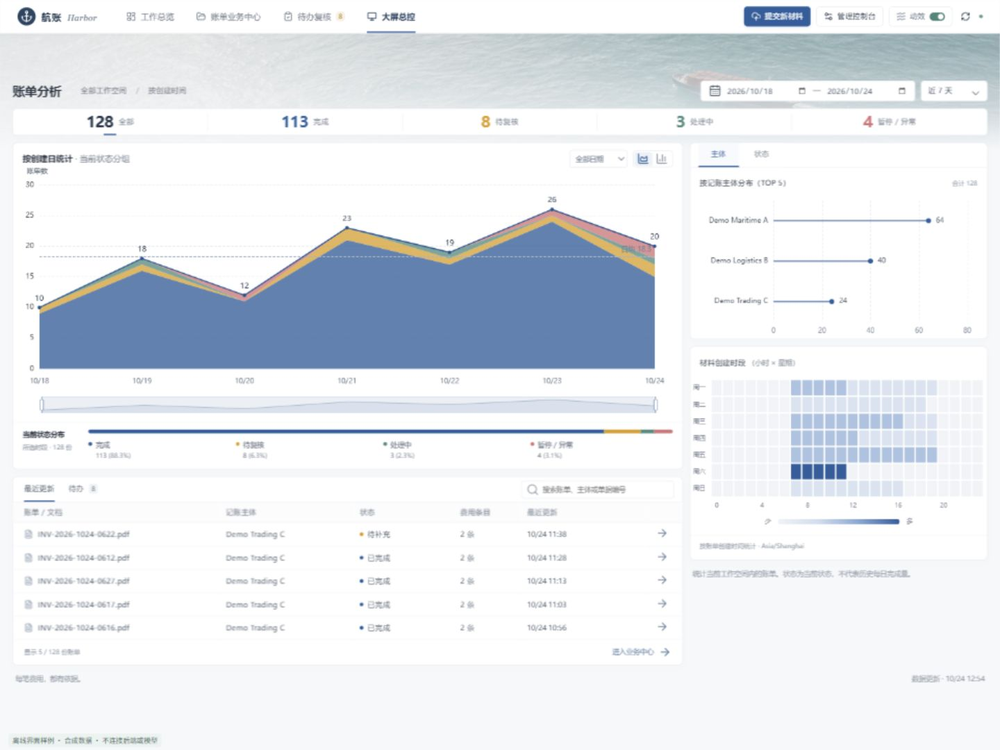

# 航账 Harbor | 项目难点与工程贡献

面向多格式航运单据的证据驱动财务智能体

版本：2026-10-24。阅读对象：技术面试官、业务评审与项目维护者。

本文围绕多格式材料理解、字段证据、财务更新、智能体收敛与人工协作，说明项目难点和已落地的工程贡献，并给出对应源码位置。

<!-- pagebreak -->

## 01 项目概要：从文档理解到可审核的账单决策

航账 Harbor 将邮件、PDF、图片与 Office 表格转化为带来源依据的费用记录，再从当前记账主体出发生成 CREATE、UPDATE、NO_CHANGE 或 PENDING_REVIEW 建议。项目的核心价值是把“识别到一个数字”推进为“这笔费用为什么成立、来自哪里、能否更新、是否可以导出”的完整业务闭环。

### 架构分工

输入层使用 Python 多格式读取器与题目指定 OCR；语义层使用 LangChain create_agent 理解单据和选择工具；复杂阅读按需交给 Deep Agents 文档专家，具体冲突按需交给账单核验专家；确定性业务层负责证据回读、Decimal 金额、四级匹配、AR/AP、版本和导出门禁。

执行、工具循环、人工中断、检查点和流式订阅复用 LangChain / LangGraph / Deep Agents 原生能力。GaussDB 保存业务版本和回执，Redis 支撑运行投影与缓存，官方 SQLite saver 保存检查点。八个业务 Skill 与十一类 Hook 划清领域逻辑和框架职责，不再额外构建第二个 Agent runner。

### 用户体验

用户提交材料后可查看各来源状态、六个核心字段、原文依据与核验结果；通过常驻聊天补充主体、提出问题或修改指定字段。人工修订产生新 Revision，旧审批失效；正式 JSON 导出必须通过当前版本校验及明确审批。



实现入口：backend/agents/factory.py；backend/middleware/assembly.py；backend/skills/；frontend/src/App.vue。

<!-- pagebreak -->

## 02 技术选择：在 LLM + OCR 链路中保留材料信息

### 项目难点

OCR 可能遗漏字符、打乱行列，返回的结构化业务字段也不等于原件逐字全文。文本模型需要结合材料上下文判断字段角色，同时遵循题目指定的 OCR 接入方式。

### 我们的贡献

采用“指定 OCR + 文本 LLM + 确定性校验”。保留 OCR 原始响应，可用 PDF 文字层、版式与 Office 单元格分别保留来源身份，供原文核对。LLM 负责语义提取，代码负责金额、匹配和证据检查，使识别结果能够回到具体单据解释。

依据：题目指定的 OCR 与 Python/LangChain要求；backend/skills/document-intake/；backend/skills/evidence-linking/。

<!-- pagebreak -->

## 03 上下文工程：保留原始证据，控制每轮输入

### 项目难点

把邮件头、签名、运输条款、附件全文、OCR JSON、历史消息和所有校验详情一股脑发给模型，会同时推高输入成本、延迟和无关信息比例。相同正文在多个回合反复出现，还会造成持续成本；更长窗口本身不保证模型稳定利用中部证据。[R4]

### 我们的贡献

材料保存在可回读的 /materials 文件和任务产物中，而非仅存于聊天。read_materials 默认以 32,000 字符判断短包：短材料一次批量返回全部来源和 ref_id；长材料返回清单，由原生 grep / read_file 或批量窗口读取相关行。截断明确返回 truncated 与 next_line，不把未读区域当作无费用。

模型复制 ref_id，宿主还原真实 source_id、anchor、quote 和位置，减少重抄长引文及偏移量。保存时一次完成证据、金额、匹配和评分核对；反馈去重后最多向模型返回 12 个具体问题，完整检查仍保存在产物。原生 ContextEditingMiddleware 在触发阈值后清理较早工具输出，保留最近结果及关键保存/询问回执。[R1]

我们减少的是重复传输与无关暴露，而非删除原件。没有让另一个模型把原文重写成一段“更通顺”的自然语言摘要，再将摘要作为唯一事实来源；这样能避免条件、否定、单位、费用归属在转述中消失。字符阈值是当前工程上限，不冒充精确 token 限额。

独立复杂疑点可交给新上下文中的专家，主控只接收简短差异、建议和真实引用；简单多文件提取直接由主控批量读取并对照，避免为每个文件机械增加一次专家调用。[R2]

实现落点：document-extraction/scripts/skill.py:read_materials、compact_feedback；middleware/assembly.py；agents/supervisor/prompt.md。

<!-- pagebreak -->

<a id="acceptance-01"></a>

## 难点 01 | 正确解析 EML 正文与附件

题目要求：能够正确解析 EML 邮件正文及附件。

### 项目难点

邮件是一个有层级的材料包。正文可能包含简短费用，附件则可能包含正式账单、提单或仅供参考的运输文件。只处理正文会漏掉真实账单；按附件数量直接生成费用又会把参考文件误当收费凭证。

### 我们的贡献

使用 Python 标准库解码 MIME、主题、收发件人与正文，处理字符编码和 plain / HTML 替代表达。附件、内嵌图片和嵌套邮件递归进入相应格式读取器；每次出现保留 parent_source_id、occurrence_id 与内容哈希。附件失败仍保留失败来源，父邮件显示 partial，而不是悄悄宣告全包成功。

模型批量阅读正文及附件，根据编号、交易关系、费用语义和更正指令建立关联。正文与附件描述同一费用时保留各自证据，确认同一业务身份后避免重复；不同真实账单分别建档。运输条款、Free 条款和缺乏已发生金额的条件收费不自动变成有效费用。

文件层级、内容相同和业务身份是不同概念。同一字节附件在两封邮件出现，能够复用识别结果，但仍应保留两次出现的上下文。这样既节约重复识别成本，也能追踪哪封邮件提供了更新指令。

实现落点：backend/skills/document-intake/scripts/skill.py；references/intake-contract.md；document-extraction/references/cross-file-review.md。

<!-- pagebreak -->

<a id="acceptance-02"></a>

## 难点 02 | 调用指定 OCR 识别 PDF 与图片

题目要求：PDF 和图片通过指定 OCR API 识别，file 为服务端可访问的下载地址。

### 项目难点

远程 OCR 不能访问本机文件路径；识别返回还可能是固定业务结构，而非逐字全文。同一文件反复识别会显著增加等待时间。重复请求相同材料会反复产生远程等待与识别成本。

### 我们的贡献

按题目固定请求协议调用 /process。需要时使用已配置 OBS 生成临时签名下载地址，不修改对象 ACL；附件、PDF 切片和图片帧各用对应文件地址。先保存 HTTP 原始字节与 JSON，再解释真实返回结构，保持 source、页范围及帧映射。服务结构化字段不能冒充原件逐字转录；可用文字层、版式及本地图片文字识别用于辅助交叉核对。

成功原始响应按文件字节哈希、端点、固定参数和契约版本缓存；同键并发识别以文件锁合并。命中后复用原始响应，重新生成本任务的来源与证据身份，不复用旧账单结论。失败、损坏或过期缓存不按成功复用。

远程识别与本地语义解析应分别优化。缓存可以消除相同输入的重复网络成本，却不能加速首次远端冷推理。保留原始响应，允许升级解析逻辑而不为相同文件重新付费识别。

实现及测量依据：document-intake/scripts/ocr_cache.py；docs/research/ocr-latency-optimization-20261023.md。

<!-- pagebreak -->

<a id="acceptance-03"></a>

## 难点 03 | 解析 Excel 与 Word 费用表格

题目要求：能够解析 Excel、Word 中的费用表格，覆盖 XLS/XLSX 和 DOC/DOCX。

### 项目难点

Excel 的显示值、公式与缓存不一定一致；隐藏表、合并单元格、小计行和跨页表头都会干扰费用识别。Word 的段落顺序、嵌套表格及内嵌图片，也不能靠简单复制全文完整表达。

### 我们的贡献

XLSX 使用 openpyxl 读取工作表、单元格、合并区域、数字格式、公式及缓存，保留 sheet / row / cell 定位。缺公式缓存时，可通过 LibreOffice 重算派生文件，保留原始公式和原缓存，不改写原件。XLS 优先转换后读取；仅缓存回退时明确公式血缘限制。

DOCX 通过 python-docx 及 OOXML 按实际内容顺序读取段落、表格、页眉页脚和嵌入图关系；图片递归进入 OCR。DOC 经 LibreOffice 转换，保留原件、派生件哈希和转换日志。Word 预览 PDF 只作为可定位阅读辅助；没有可靠映射时，不伪造原文物理页码。

能读取一个数值，不等于能解释它来自公式、缓存还是人工输入。保留单元格和转换血缘，既帮助模型识别字段，也支持人类回到原位置复核。小计、总计和重复表头保留角色，不能重复生成费用。

实现落点：document-intake/scripts/skill.py；references/intake-contract.md；backend/tests/fixtures/office/。

<!-- pagebreak -->

<a id="acceptance-04"></a>

## 难点 04 | 准确提取编号、费用、金额与币种

题目要求：准确提取单据编号、费用、金额和币种，并保留处理依据。

### 项目难点

单据编号可能与提单号、订舱号并列；金额列可能与数量或单价紧邻；币种可能只出现在表头。裸 $、¥ 等符号缺乏唯一币种含义；相邻文件的币种也不能直接借用到另一张账单。

### 我们的贡献

模型从每份材料按单据和费用语义提出候选，保留 raw_charge_item、raw_amount、raw_currency 等原值。已知费用别名、ISO 币种和 PP/CC 由领域规则标准化。模型引用 ref_id 并说明支持字段，证据包回到真实来源验证引文和位置；字段之间分别核对，而非“某段文字出现过就全部有效”。

金额内部使用 Decimal，区分数量、单价、费用金额、折扣和总计；可用 PDF 版式财务行按列验证，防止把相邻的 65.00 与 1.00 拼为一个金额。不同单据与币种各自核对合计。原文无法确定的字段留 null，保留缺口与候选，不从地理位置或历史习惯补造。

LLM 擅长识别字段角色与语义，代码更适合精确数值和来源验证。两者合作能把“模型看起来很确定”转为可检查的业务事实。置信度来自证据支持和一致性，它是复核优先级，不是统计正确率。

实现落点：document-extraction、evidence-linking、billing-reconciliation、billing-confidence 四个 Skill；docs/research/extraction-harness-4-8-20261023.md。

<!-- pagebreak -->

<a id="acceptance-05"></a>

## 难点 05 | 区分新增与增量更新

题目要求：无匹配时 CREATE，匹配后仅更新材料明确要求修改的字段，其他字段继承。

### 项目难点

“找到相似旧账单”“看到新旧金额不同”“获得更新授权”是三件事。把差异直接理解为 UPDATE，会误覆盖旧值；把匹配失败当无匹配，又可能重复建账。

### 我们的贡献

工作台默认自动查询同主体的合格历史记录，同时兼容调用方显式提供的已有账单 JSON。匹配按题目顺序执行：单据编号与费用名；提单号、费用名与币种；订舱号、费用名与币种；箱号、交易双方、日期与金额。候选必须唯一，多候选或多行复用同一旧行时进入复核。

无匹配且数据有效时 CREATE；唯一重复且无差异时 NO_CHANGE；存在明确更新指令时 UPDATE。changes 只携带授权字段：键缺省继承原值，明确 null 才表示清空。聊天或人工表单修改落到同一个 Revision 体系，更新后重新核验。历史查询失败不能授权 CREATE，审批及正式导出前重查候选摘要，历史变化时阻断旧结果。

用事实确定匹配范围，用明确意图确定修改范围，防止模型把“合理猜测”变成写入许可。历史候选不把 OCR 和整段对话搬入当前上下文，减少噪声和额外模型调用。

实现落点：billing-reconciliation/references/contracts.md；backend/tools/history.py；docs/research/automatic-history-20261023.md。

<!-- pagebreak -->

<a id="acceptance-06"></a>

## 难点 06 | 从记账主体视角判断 AR/AP

题目要求：结合签发方、接收方、当前记账主体和收费方向判断，不能只看 Debit Note / Credit Note。

### 项目难点

同一张单据，对出票方可能是应收，对接收方可能是应付。PP/CC 表示支付条款，并不直接等于 AR/AP；Credit Note 或负数也不能机械反转记账方向。

### 我们的贡献

用户指定当前记账主体；模型根据材料识别真实收付款关系，形成 creditor / debtor 及字段引用。代码按主体与债权债务关系判断：主体为债权人则 AR，为债务人则 AP。只明确其中一方、且已足以确定当前主体角色时，可以判断方向，另一交易方仍留 null。

主体缺失时先保存已有候选及证据，以原生人工中断询问主体；关系仍不明或矛盾时，只询问具体无法解决的问题。主体已确认后，后续费用修改不会重新进入全单主体提取；未解决待办独立提醒，优先处理用户本轮目标。

AR/AP 是记账视角下的业务结论，而非文档分类结果。主体是用户授权的业务上下文，不能由模型临时假定；收付款关系又必须来自材料或明确补充，避免“知道公司名字就知道方向”的错误推断。

实现落点：billing-reconciliation/scripts/skill.py；backend/tools/human_input.py；middleware/conversation.py；docs/research/bill6-reply-fix-20261024.md。

<!-- pagebreak -->

<a id="acceptance-07"></a>

## 难点 07 | 检测重复账单与数据冲突

题目要求：检测重复提取、重复账单、金额冲突和 OCR 易混淆字符问题。

### 项目难点

相同文件不等于相同业务费用，不同文件也可能描述同一笔费用。模型修复时如果不断追加新 charge_id，同一费用会越修越多，合计不断失败；另一方面，同名同金额的真实独立费用不能随意合并。

### 我们的贡献

分三层处理：文件内容哈希用于复用解析；source / document / charge 稳定身份用于区分来源与费用；业务匹配规则用于判断历史重复。同来源、名称、金额、币种唯一匹配且无身份冲突时，匿名纠错复用已保存费用身份，避免重复追加；身份不唯一则保留冲突。

金额、币种、合计及原文角色通过独立 Hook 核验。识别 0/O、1/I 等疑点时，结合格式约束、原位置与关联编号定向重读；缺乏唯一证据时保留歧义，不对所有编号执行全局字符替换。条件收费、总计、表头和运输参考信息也不作为普通费用重复输出。

技术去重负责消除重复工作，业务去重负责判断经济事项，二者不能共用一条简单哈希规则。冲突应保留双方来源和具体字段，供模型定向判断或人工处理，而非为了让合计相等强行删改。

实现落点：human-review、evidence-linking、billing-reconciliation；docs/research/loop-controls-20261023.md；backend/tests/test_simple_bundle.py。

<!-- pagebreak -->

<a id="acceptance-08"></a>

## 难点 08 | Harness：从错误诊断到任务恢复

题目要求：设计 harness 工程，提升当前场景的稳定性和输出准确性。

### 项目难点

智能体遇到失败时，单纯增加重试次数会重复消耗，单纯设置上限又不能解决业务问题。需要回答的是：为什么失败、哪一步已经成功、应该换什么处理方式、如何带着已有成果继续完成，以及真正缺少事实时由谁补充。

### 我们的贡献

- 分类处理：网络暂态、工具参数错误、模型误读、证据缺失、业务冲突与运行异常分别处理。网络恢复靠有界重试；参数或语义错误回传具体问题；缺主体和真实收付款关系则定向询问，避免让模型猜。
- 定向修复：根据字段级 issues 找到对应费用、来源和原文窗口，只补读相关表格或附件，修改有依据的字段。已有正确金额与引用保持稳定，复杂疑点才委派专家，不因一个字段失败重做整包。
- 保留进度：原件、OCR 原始响应、提取候选、成功工具回执和当前 revision 分层保存。缓存复用识别事实；修复使用当前费用 ID，避免重复收费、重复 OCR 或覆盖新版本。
- 接续完成：原生检查点与 interrupt 支撑暂停后的继续；普通新消息、人工补充和失败重试使用各自入口。已有合法修订提案直接提交重算；用户补充事实后只重新核对受影响字段。
- 明确交接：无进展时把问题收敛为具体待办，说明已完成内容、阻塞字段、所需证据与下一步动作。人工补充和失败重试沿用已有产物及版本，接续处理具体缺口。
- 质量与成本：十一类 Hook 保持证据、金额、匹配、版本和审批门禁。共享预算与重复调用拦截是最后保护线；业务完成依赖问题解决及当前版本核验，不能用“调用结束”代替完成。

错误类型决定恢复方法：暂时失败可以重试，错误读法需要改变材料或判断方式，缺少事实需要补充信息。重试上限无法替代这些方法。官方运行时提供检查点、恢复与中断机制，领域 Hook 保证修复不会破坏财务事实；主控据具体问题选择下一步，无需新增一个持续付费的监督 Agent。[R1-R3、R5]

实现落点：backend/harness/；middleware/assembly.py、reply_decision.py、handoff.py；config/runtime.yaml、hooks.yaml。

<!-- pagebreak -->

<a id="acceptance-09"></a>

## 难点 09 | 将隐含业务风险落实到工程约束

围绕题目的业务要求，将十类容易遗漏的财务风险落实为具体处理机制。

### 项目难点

财务提取还面临缺失误补、条件误用、更新越权和旧审批沿用等风险。文件可读、JSON 合法，并不等于账单已具备可审核的业务依据。

### 我们的贡献

1. **缺失与零值：** 防止缺金额被补0。当前缺失留 null、原值单独保存。
2. **条件费用：** 防止把 Free 或超期收费条款直接记账。当前核对真实发生证据。
3. **跨币种：** 防止混加 USD 与 CNY。当前按单据及币种分组。
4. **更新授权：** 防止差异自动覆盖。当前只改明确字段、其余继承。
5. **可追溯：** 防止高分却无法定位。当前保存 ref_id、原文与锚点。
6. **版本化审核：** 防止改完沿用旧审批。当前新 revision 重算。
7. **参考经验：** 防止历史经验补造事实。当前 AI 总结、人工确认、同主体 BM25 检索与总开关。
8. **识别缓存：** 防止沿用旧财务结论。当前只复用原始 OCR 响应并重建来源。
9. **阶段性能：** 防止把远程等待当作模型思考。当前拆分上传、OCR HTTP、模型、工具与人工等待。
10. **自主边界：** 防止流程僵化或无限执行。当前按需工具选择、代码门禁与可恢复接续。

这些风险分别落到数据语义、更新权限、证据、版本和执行边界，不能只依赖一句“请仔细检查”。将它们变为可定位的规则与回执，才能解释一次失败、控制影响范围并允许人工接续。

实现落点：docs/insights.md；automatic-history、experience-library、loop-controls、ocr-latency 等研究记录。

<!-- pagebreak -->

<a id="acceptance-10"></a>

## 难点 10 | Python + LangChain 的可维护实现

题目要求：基于 Python 和 LangChain 代码实现，提供代码 ZIP 或 Git 仓库。

### 项目难点

将解析、模型、数据库、人工交互与财务逻辑写在一段长提示词或单个脚本中，难以调试、迁移和独立验证。反过来，过度拆成多个 Agent 和自建执行器，又会增加运行成本与状态同步风险。

### 我们的贡献

后端以 Python 包组织。LangChain 主控与 Deep Agents 专家复用原生工具、SkillsMiddleware、FilesystemMiddleware、HITL 和检查点，官方 Agent Server 负责运行与订阅。Vue + TypeScript 工作台使用官方 SDK，避免另造一层 SSE。复杂能力可通过 MCP 接入，领域能力封装为八个可独立调用的 Skill。

八个包分别承担接入、提取、证据、匹配、置信度、人工修订、JSON 导出和反馈改进；十一类 Hook 提供统一业务约束。依赖版本由 requirements.lock.txt 与 package-lock.json 固定。Windows 便携解释器通过 start.cmd / backend/python.cmd 定位，运行已构建页面不要求另装 Node.js，前端开发构建才需要 Node。

框架负责执行语义，Skill 负责航运账单语义，Hook 负责不可绕过的约束。规则可以独立测试和迁移，新增能力不必重写主控循环。当前锁定组合包括 LangChain 1.4.6、LangGraph 1.2.16、Deep Agents 0.7.30，不将在线最新文档当作自动升级依据。

代码位置：backend/agents、middleware、tools、hooks、harness、skills；frontend/src；backend/requirements.lock.txt。私人 Git 仓库由现有账号权限共享，不公开业务原件与密钥。

<!-- pagebreak -->

<a id="failure-recovery"></a>

## 14 异常恢复：保留已有成果并接续处理

### 项目难点

一次工具失败不应迫使整个材料包重新开始；一次字段修复也不能覆盖已有正确证据。任务还需要区分缺少事实、错误参数、暂态服务异常和没有新进展等不同情况。

### 我们的贡献

| 具体问题 | 已落地的处理机制 |
| --- | --- |
| 暂态请求失败 | 有界重试，保留错误来源与派发回执；成功OCR响应按契约缓存 |
| 参数错误或字段误读 | 返回具体工具/字段反馈，提供原文窗口与局部修订入口 |
| 币种或关系没有证据 | 保存已有字段与引用，缺失留null，提出具体人工补充问题 |
| 重复修复没有进展 | 保存候选、缺口和待办，由明确人工回复或重试接续 |
| 已有成功修订提案 | 复用提案提交重算，以回执和revision保护成功动作 |

以币种缺失为例：保留已有证据的金额及费用ID，补读相关附件或表头；仍缺事实时具体询问币种或清晰原件。回复后对同笔费用生成新revision，继承其他字段，重算相关核验，再进入当前版本审核与导出。

实现依据：backend/middleware/dispatch.py、reply_decision.py；backend/harness/；human-review；docs/research/bill7-conversation-convergence-20261024.md。

<!-- pagebreak -->

## 15 标准输出与一次业务闭环

### 输出与题目一致，内部信息另行保存

正式输出是顶层 JSON 数组，每笔费用一条。保留 operation、document_info、transaction_party、charge_details、financial_attributes 和 audit_trail 六组字段；原始费用名、证据、候选与版本留在内部审计产物中。金额由 Decimal 安全序列化为 JSON number；NaN、Infinity 与布尔值不能伪装成金额。题目示例中的尾逗号在实际导出中不会保留。

以下为明确构造的合成示例，不是从真实原题材料提取的结果：

```json
[
  {
    "operation": "CREATE",
    "document_info": {
      "document_type": "Invoice",
      "reference_no": "DEMO-2026-001",
      "document_date": "2026-10-21"
    },
    "transaction_party": {
      "issuer": "Demo Logistics Ltd",
      "recipient": "Demo Trading Ltd"
    },
    "charge_details": {
      "charge_item": "Handling Charge",
      "amount": 50.00,
      "currency": "USD",
      "payment_term": null
    },
    "financial_attributes": {
      "accounting_entity": "Demo Trading Ltd",
      "posting_type": "AP"
    },
    "audit_trail": {
      "ai_reasoning": [
        "当前主体为费用债务人；未匹配到旧账单",
        "付款方式未提供，保留 null"
      ]
    }
  }
]
```

闭环：提交材料并明确主体 → 保存候选与证据 → 自动核验及历史匹配 → 必要时人工补充或修订 → 当前版本通过校验并获批准 → 正式导出。可带缺口结束处理、查看草稿；处理结束、人工修改和正式批准是不同状态。

实现落点：billing-export/references/contracts.md；human-review；frontend/src/components/TaskWorkspace.vue。

<!-- pagebreak -->

## 16 工程贡献与源码落点

### 项目难点

材料读取、语义理解、财务规则、人工修订与执行状态需要协同，同时保持责任清楚，使每个结果能够解释、定位和修改。

### 我们的贡献

| 贡献 | 源码位置 |
| --- | --- |
| 多格式材料接入与OCR成功缓存 | backend/skills/document-intake/ |
| 自主读取、候选提取与跨材料核对 | backend/skills/document-extraction/；backend/agents/ |
| 字段引用回读与原文定位 | backend/skills/evidence-linking/ |
| 历史匹配、金额核对与增量继承 | backend/skills/billing-reconciliation/ |
| 证据支持评分与复核分流 | backend/skills/billing-confidence/ |
| 版本化修订、审核和JSON导出 | human-review、billing-export；backend/api/ |
| 共享计量、证据保护与任务接续 | backend/harness/；backend/middleware/ |
| 经验草稿、确认检索与规则发布 | backend/skills/feedback-improvement/ |
| 常驻聊天、独立待办和消息同步 | frontend/src/components/AgentPanel.vue；frontend/src/utils/ |

这些职责通过明确来源、费用ID、revision及成功回执连接，支持从材料到人工修订再到正式输出的业务闭环。

<!-- pagebreak -->

## 17 演示、交付与参考资料

### 建议的评审演示顺序

1. 从 start.cmd 启动已配置的本机服务，进入 /app/；不将离线 UI 合成预览当成真实业务链路。
2. 选用明确标记的 synthetic-invoice.xlsx，填写 Demo Trading Ltd，先查看两笔合成费用与来源，再说明 CREATE / AP 的依据。
3. 选择一笔费用改金额，展示新 revision、重新核验及旧审批失效；只改变用户明确指定字段。
4. 展示历史匹配四级顺序、差异与更新指令的区别、缺失 null 和正式导出门禁。
5. 通过已有回执讲解 OCR 缓存、错误定位、局部修复和人工接续，展示失败后的下一步动作；不为演示临时触发昂贵全量模型测试。

### 交付内容

根 README.md 提供项目定位、架构、启动和验收导航；本文 Markdown 为可编辑技术答辩稿，PDF 为评审阅读版。源码和依赖锁文件纳入私人 Git 仓库；密钥、业务原件、运行数据库和完整真实模型对话不进入文档包。

### 原题与官方资料

- [R0] 用户提供《AI agent 笔试题》HTML，重点核对项目目标、核心功能、处理要求及10条验收标准。
- [R1] LangChain：内置 middleware 与 context engineering，2026-10-24通过已配置 Docs MCP复核。https://docs.langchain.com/oss/python/langchain/middleware/built-in
- [R2] Deep Agents：上下文隔离、子智能体与文件外置。https://docs.langchain.com/oss/python/deepagents/context-engineering
- [R3] LangGraph：interrupt / resume 与持久化语义。https://docs.langchain.com/oss/python/langgraph/interrupts
- [R4] Liu et al., Lost in the Middle: How Language Models Use Long Contexts, arXiv:2307.03172。长上下文信息位置敏感性的研究依据，不作为本项目准确率或特定当前模型的测试结果。https://arxiv.org/abs/2307.03172
- [R5] LangGraph：按错误类型处理与重执行幂等性，2026-10-24经Docs MCP复核。https://docs.langchain.com/oss/python/langgraph/thinking-in-langgraph#handle-errors-appropriately ； https://docs.langchain.com/oss/python/langgraph/graph-api#re-execution-and-idempotency

### 本项目实现证据入口

backend/agents/supervisor/prompt.md；backend/middleware/assembly.py；backend/harness/；backend/config/runtime.yaml；backend/config/hooks.yaml；backend/skills/；docs/research/automatic-history-20261023.md；docs/research/persistent-chat-20261023.md；docs/research/delegation-convergence-20261023.md；docs/ui-design.md。

阅读顺序：先看项目整体与上下文组织，再按十类难点查看贡献，最后结合源码落点理解工程实现。
