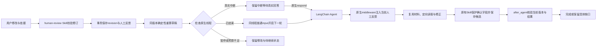

# Harness人工反馈闭环，2026-10-22

## 实际问题

`vsdv`（96b63c2b-6e66-45aa-8f79-273a8c6ba547）原运行已结束。人工补充主体生成revision 2后，旧PATCH接口只执行prepare_recalculation、reconcile_saved和settle_saved；没有新的Agent调用，人工填写的“核对第一页”也没有交给模型。原有debtor为null，所以确定性财务函数无法得出AR/AP。这是运行生命周期与业务修订之间的断点。

## 当前边界

- `harness/feedback.py`只保存反馈上下文和展示给Agent的说明；不实现领域规则或运行循环。
- `api/task_runtime.py`适配官方Agent Server：结束后用普通messages input；有原生中断时保留问题，不能伪造确认或用force_resume将补主体冒充工具答复。暂停执行的剩余节点使用原生检查点继续。
- `middleware/feedback.py`使用原生ModelRequest.override(system_message=...)，使主控及按需专家在每次实际模型调用时获得当前revision的修订依据；失败模型调用不标记已读取反馈。未向检查点反复追加系统历史。
- `middleware/outcome.py`绑定构建时revision；旧运行不能结束新版本。反馈未被模型读取时不能凭既有records冒充完成；正常结束后再执行同版本财务与导出核验，保留completed_with_gaps语义。
- `tools/context.py`提供最新候选、人工确认值与反馈；正文仍由已有材料工具读取。未修改已发布Skill，也未迁移任务能力。
- `tools/skill_bindings.py`优先复用任务内成功接入产物，保留补读表示；不能让旧Redis缓存替换已补充材料。失败材料与显式变更接入参数仍可实际重试。
- `feedback.state`记录人工反馈是否已派发和处理；`run_status`记录框架执行结果；`status`记录账单业务结果。三者职责不同。续跑不重置同一任务的共享预算，不自动批准账单。
- 派发前以revision和当前反馈状态做事务检查，官方multitaskStrategy=reject处理运行并发。启动/状态读取失败保留已提交修改，现有control.resume重试派发，不再次应用人工编辑。正式审批/导出要求反馈已经处理。
- 显式继续历史人工修订时，从现有history恢复本次反馈，不增加业务revision，不改人工值或不可变能力。没有显式继续动作时不批量启动历史任务。

## 官方能力查证

先通过LangChain Docs MCP查阅`oss/python/langgraph/graph-api`的Input to invoke or stream、`oss/python/langgraph/interrupts`的Resuming interrupts，以及`oss/python/langchain/middleware/custom`的Dynamic prompt。官方已提供同线程多轮input、Command(resume)、模型请求覆盖和after_agent，全部直接使用。安装版langchain 1.4.6/langgraph 1.2.16/deepagents 0.7.29/API 0.16.2；源码核对Agent Server event_streaming/service.py的run.start与force_resume转换。项目只补框架无法知道的HTTP业务revision与反馈记录适配，不新建runner、消息队列或Skill执行器。

API Reference MCP的首次ModelRequest/RunsClient精确符号查询未命中，不据此推断能力缺失；以Docs正文、安装版源码及原生集成验证为依据。

## 验证与边界

27项定向测试通过，1项既有LangChain MCP beta warning，10.01秒；未做全量测试。报告：`backend/tests/reports/harness-feedback-pytest.xml`。覆盖同线程新轮、真实interrupt/resume、人工值保护、补齐关系后AP、成功材料不重新接入、暂停、预算耗尽、启动/检查点查询失败重试、历史修订显式继续、原生失败可恢复、旧版本冲突和快速结束不被运行受理响应覆盖。合成关系测试中的Client明确出现在“Client pay Carrier”原文，不能推断真实PDF中的公司标志必为付款方。

Vue类型及生产构建通过：2418 modules、Vite1.06秒，入口index-BCMdTNjk.js；增加“继续处理”和反馈状态提示，沿用现有组件样式。在线重启与vsdv结果以acceptance.md最新记录和harness-feedback相关JSON回执为准。此项不是准确率评测或20秒端到端承诺。

## 实际vsdv续跑回执补充

任务96b63c2b-6e66-45aa-8f79-273a8c6ba547在原thread/revision2/能力87974856e3c7561e83cd上完成一次真实续跑，run=01a15f4a-ecfc-74f3-adad-6fe0b881e16e。增加3次模型、2次工具、32.667秒活跃处理，feedback.model_seen=true，最终completed_with_gaps。原材料、history、人工主体、revision、thread和能力哈希均不变，没有重复OCR。现有原文未明确写出付款方，Agent保留三项AR/AP为null；未把公司标志直接当作debtor。这是实际读取人工反馈并继续核对的证据，不代表业务缺口已补全，也不代表20秒目标已达标。报告harness-feedback-live.json。
