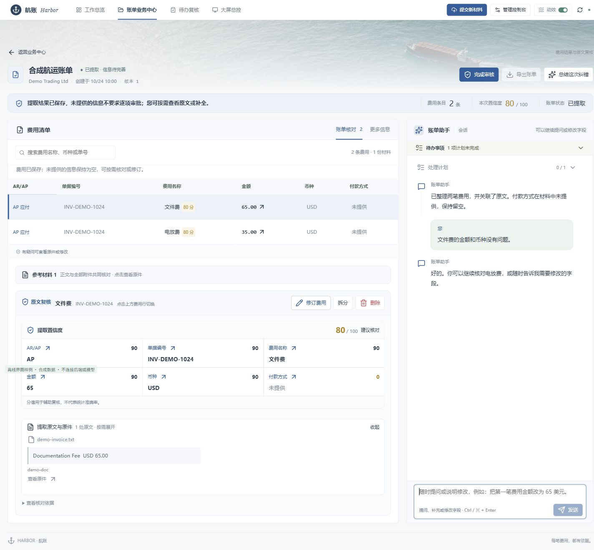

# 工作台界面与交互

当前为Folio工作台：灰白与深蓝、紧凑字号、横向导航、ECharts统计及融入顶部背景的海景。海景随页面滚走，只有导航固定。生产素材在frontend/src/assets/，下图为合成数据。

## 布局与操作

工作总览、大屏、业务中心、待办、提交材料和管理中心分别承载操作。按钮集中在对应面板标题附近，不使用遮挡内容的悬浮操作面板。

账单默认核对AR/AP、单据编号、费用名称、金额、币种和付款方式。原文、置信度和更多字段按需查看，缺失值不猜填。修订绑定当前费用和revision。

桌面费用与聊天位于同一Grid行，拉伸为相同高度，随页面滚动；消息在面板内滚动，标题和输入区紧凑。手机为单列，聊天采用独立窗口比例高度。不再按初始文档位置计算固定聊天高度。

日期可直接选起止日并联动图表和列表，保留7天、30天、全部。动效可关闭并持久化，尊重系统减少动效。统计不虚构准确率或跨币种总金额。

## 聊天与同步

聊天常驻，可提问或明确修改指定字段；未完成待办独立提醒，旧问题不覆盖当前意图。真实interrupt按其身份恢复，处理中可写草稿，运行结束后发送。

检查点顺序与message.id衔接实时投影，补齐漏到回复，避免重复问题。底部跟随新消息，向上阅读保持位置。业务完成、运行空闲、人工批准分开判断，不能让残留pending把已批准账单显示为材料处理中。

App.vue管理导航和摘要/详情读取；pages/组织页面，components/承载账单、助手和证据，utils/taskPresentation.ts统一状态。官方@langchain/vue订阅消息、todos、工具、专家与中断，不另造Agent流协议。

## 既有核验

21项消息、状态、日期定向检查与Vue类型/生产构建通过；合成页面核对桌面、390px、日期、原文抽屉、海景滚出页面和动效开关。

助手修复核对1280/1440宽，两列均826.01px，展开证据后均969.14px，滚动后仍对齐；390px聊天590.79px、输入区83.33px，无横向溢出和控制台error。本次整理只迁移已有截图，没有重跑浏览器或提交真实消息。

命令与路由见 [前端README](../frontend/README.md)，验证范围见 [验收记录](acceptance.md)。
